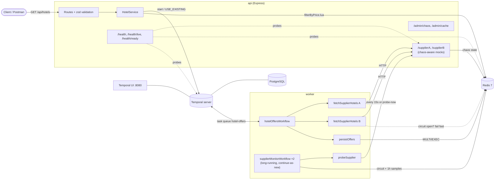
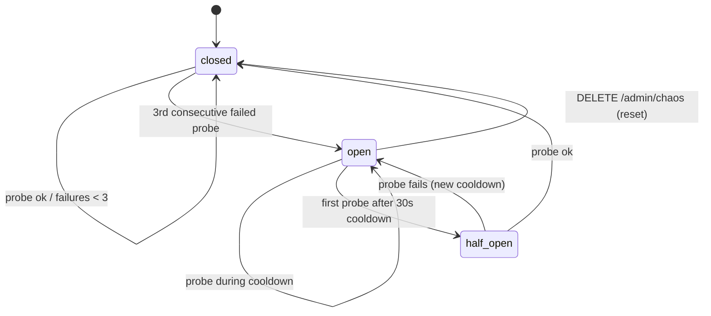

# Hotel Offer Orchestrator

> **TODO before publishing:** replace the `OWNER` placeholder with your GitHub user or organisation in
> (1) the CI badge URL just below and (2) the `git clone` URL under
> [Deployment → Any Linux VM](#a-any-linux-vm-ec2-digitalocean--with-docker-compose).

[](https://github.com/OWNER/hotel-offer-orchestrator/actions/workflows/ci.yml)


A hotel offer aggregator built with Temporal. For a city, it asks two suppliers for hotels **in parallel**,
merges duplicates, and keeps the **best offer per hotel**: the cheaper one, or on a price tie the one with the
better commission. It returns a deterministic JSON array. Results are cached in Redis, and **price filtering
runs inside Redis** with one atomic Lua call. The service stays useful when things break: if one supplier is
down you get a partial result, if both are down you get an honest `503`, and concurrent requests for the same
city share **one** workflow execution. Chaos endpoints let you show each failure mode live.

---

## Contents

- [Architecture](#architecture) · [Features](#features) · [Quick start](#quick-start) · [API reference](#api-reference)
- [Design decisions](#design-decisions) · [Resilience demo](#resilience-demo) · [Configuration](#configuration)
- [Testing](#testing) · [Deployment](#deployment) · [Project structure](#project-structure)
- [Troubleshooting](#troubleshooting) · [Future improvements](#future-improvements)

**Project docs:** [original assignment spec](docs/SPEC.md) ·
[build report (how it was built and verified)](docs/BUILD_REPORT.md) · [v2 enhancement plan](ENHANCEMENTS.md)

## Architecture

Two processes are built from **one Docker image**. The **api** process serves the public API, the mock
suppliers, health checks, chaos/admin and `/docs`, and starts workflows. The **worker** process runs the
workflow and its activities. Activities reach the suppliers over real HTTP (`http://api:3000/supplierX/hotels`),
so latency, failures and timeouts are real.



### Workflow sequence, including the partial-failure path

```mermaid
sequenceDiagram
  autonumber
  participant C as Client
  participant API as api
  participant T as Temporal
  participant W as worker (workflow)
  participant A as Supplier A
  participant B as Supplier B
  participant R as Redis

  C->>API: GET /api/hotels?city=delhi
  API->>API: validate + normalise city
  API->>T: start hotel-offers-delhi (conflict policy USE_EXISTING)
  Note over API,T: concurrent requests for delhi attach to the SAME run
  T->>W: run hotelOffersWorkflow({city, requestId})
  par Promise.allSettled
    W->>A: fetchSupplierHotels(A)
    A-->>W: 200 [6 hotels]
  and
    W->>B: fetchSupplierHotels(B)
    B--xW: 503 / timeout
    W->>B: retry (backoff 300ms → 600ms, max 3 attempts)
    B--xW: still failing → B marked "down"
  end
  alt both suppliers failed
    W-->>T: ApplicationFailure AllSuppliersUnavailable
    T-->>API: WorkflowFailedError
    API-->>C: 503 SUPPLIERS_UNAVAILABLE
  else at least one supplier answered
    W->>W: selectBestOffers() — pure, deterministic
    W->>R: persistOffers: MULTI DEL/ZADD/HSET/HSET meta/EXPIRE (TTL 30s if partial)
    W-->>T: {offers, suppliersStatus, resultStatus, decisions}
    T-->>API: result
    API-->>C: 200 [...] + X-Result-Status: partial, X-Suppliers-Status: A=up;B=down
  end
```

## Features

**Core (graded contract)**

- `GET /api/hotels?city=…` returns a **bare JSON array** of `{name, price, supplier, commissionPct}`, sorted by
  price, then name. Every call runs a fresh Temporal workflow.
- `GET /api/hotels?city=…&minPrice=&maxPrice=` filters **inside Redis**: a sorted set plus one Lua script.
  Bounds are inclusive and either one is optional. Results come from the cache (`X-Cache: HIT`) or from a
  workflow run first (`MISS`), and `refresh=true` forces a new run.
- Two parallel supplier activities with retries, a pure `selectBestOffers`, and an atomic Redis write.
- Strict validation (400), `200 []` for unknown cities, `503` when both suppliers are down, and partial results
  when one is down.

**Bonus and distinguishing features**

- ⭐ **Request coalescing.** Concurrent requests for a city share one workflow execution
  (`workflowIdConflictPolicy: USE_EXISTING`), proven by a test against the real Temporal dev server and by a demo script.
  **Benchmarked:** 100 concurrent requests → 6 workflow runs and 12 supplier calls, vs 100 runs and 200 calls without
  coalescing. At N=200, supplier traffic is 16.7× lower and p95 is 4.8× faster ([docs/benchmarks.md](docs/benchmarks.md)).
- ⭐ **Explainability.** `GET /api/hotels/insights` shows, for each hotel, both offers, the winner, the reason
  and the savings, plus totals.
- ⭐ **Live progress query.** The workflow answers a `status` query (`fetching → selecting → persisting → done`
  plus per-supplier state).
- ⭐ **Supplier monitors and a circuit breaker.** Two long-running workflows (`supplier-monitor-A/B`) probe
  each supplier on a durable timer and continue-as-new every 100 iterations. They drive a
  `closed → open → half_open` breaker stored in Redis. While a circuit is open, requests skip that supplier
  instantly: a partial result in about 0.15 s instead of about 2 s of retries, plus `X-Circuit-State: A=closed;B=open`.
  `/health` gains a per-supplier `monitor` block (uptime % over the last hour, last check, consecutive failures, circuit).
- ⭐ **Chaos engineering.** Each supplier can be set to `down`, `slow` or `flaky` over HTTP, with state shared through Redis.
- `/health` probes both suppliers, Redis and Temporal in parallel with real latency and reports `up`, `degraded`
  or `down`. There are also `/health/live` and `/health/ready`.
- **End-to-end tracing.** `X-Request-Id` goes into the workflow memo and into every activity log line, as
  structured pino JSON. Temporal SDK and core logs go to the same logger.
- Typed `AppError`s and one error handler that maps Temporal failures to `503`/`504` with one error shape.
- OpenAPI 3 docs at **`/docs`**, `helmet`, rate limiting, no `x-powered-by`, and graceful shutdown for both processes.
- A Debian-slim multi-stage image (non-root, pre-bundled workflow code), healthchecks on every compose
  service, and a one-command stack.
- CI runs lint, format, typecheck, unit, workflow and integration tests, the Docker build, the coalescing demo
  and **newman**.

## Quick start

**Prerequisites:** Docker with Compose v2. Node 24 LTS (see `.nvmrc`) is needed only for local dev, tests and newman.

```bash
cp .env.example .env
docker compose up --build          # add -d to detach; first boot takes ~1 min
```

All six containers (`postgresql`, `temporal`, `temporal-ui`, `redis`, `api`, `worker`) become `healthy`:

```bash
docker compose ps
curl -i "localhost:3000/api/hotels?city=delhi"
curl -i "localhost:3000/api/hotels?city=delhi&minPrice=5000&maxPrice=9000"
curl    "localhost:3000/api/hotels/insights?city=delhi"
curl    "localhost:3000/health"
```

- **Temporal UI:** <http://localhost:8080>. Open the `default` namespace and find workflow `hotel-offers-delhi`.
  Its **Queries** tab can run `status`.
- **API docs (Swagger UI):** <http://localhost:3000/docs> (raw spec at `/openapi.json`)

Expected `GET /api/hotels?city=delhi`:

```http
HTTP/1.1 200 OK
X-Request-Id: daef26cf-50f8-4a84-879f-3effc4a53ac1
X-Workflow-Id: hotel-offers-delhi
X-Workflow-Run-Id: 01a1f9e0-afc4-7796-9286-88169dbcb240
X-Suppliers-Status: A=up;B=up
X-Result-Status: complete
X-Cache: MISS
X-Response-Time: 563.1ms

[{"name":"Ibis","price":2900,"supplier":"Supplier B","commissionPct":9},
 {"name":"Lemon Tree","price":3200,"supplier":"Supplier A","commissionPct":8},
 {"name":"Holtin","price":5340,"supplier":"Supplier B","commissionPct":20},
 {"name":"Radison","price":5900,"supplier":"Supplier A","commissionPct":13},
 {"name":"Hyatt Regency","price":8400,"supplier":"Supplier B","commissionPct":16},
 {"name":"The Leela","price":9800,"supplier":"Supplier A","commissionPct":12},
 {"name":"Taj Palace","price":11900,"supplier":"Supplier B","commissionPct":18}]
```

### Local development (without containerising the app)

```bash
nvm use                                   # Node 24.22.3
npm ci
docker compose up -d redis temporal temporal-ui   # infra only
npm run dev:api      # tsx watch, loads .env
npm run dev:worker   # in a second terminal
```

## API reference

Every error, on any route, has the same shape. Stack traces appear only when `NODE_ENV=development`:

```json
{
  "error": {
    "code": "VALIDATION_ERROR",
    "message": "Invalid request",
    "details": [{ "path": "minPrice", "message": "minPrice must be <= maxPrice" }],
    "requestId": "4f9c7d1e-2b1a-4f0e-9a51-3c2d8e7b6a10"
  }
}
```

| Code                    | HTTP | When                                                          |
| ----------------------- | ---- | ------------------------------------------------------------- |
| `VALIDATION_ERROR`      | 400  | bad/missing query, unknown parameter, `minPrice > maxPrice`   |
| `UNAUTHORIZED`          | 401  | `/admin/*` without the right `x-admin-token` (if configured)  |
| `NOT_FOUND`             | 404  | unknown route                                                 |
| `RATE_LIMITED`          | 429  | more than `RATE_LIMIT_MAX` requests per window on `/api`      |
| `WORKFLOW_FAILED`       | 502  | workflow failed for an unexpected reason                      |
| `SUPPLIERS_UNAVAILABLE` | 503  | **both** suppliers failed after retries                       |
| `TEMPORAL_UNAVAILABLE`  | 503  | Temporal unreachable (bounded by `TEMPORAL_START_TIMEOUT_MS`) |
| `REDIS_UNAVAILABLE`     | 503  | Redis unreachable (read or persist)                           |
| `WORKFLOW_TIMEOUT`      | 504  | workflow exceeded `WORKFLOW_EXECUTION_TIMEOUT` (30s)          |

### `GET /api/hotels`

| Param      | Required | Rules                                                                    |
| ---------- | -------- | ------------------------------------------------------------------------ |
| `city`     | yes      | trimmed, lowercased; letters (any script), spaces, hyphens; ≤ 50 chars   |
| `minPrice` | no       | finite number ≥ 0, inclusive (`-inf` when missing)                       |
| `maxPrice` | no       | finite number ≥ 0, inclusive (`+inf` when missing); must be ≥ `minPrice` |
| `refresh`  | no       | `true`/`false`. Forces a workflow run before filtering                   |

- **No price params:** the workflow runs every time and refreshes the cache. The response has `X-Cache: MISS`.
- **With price params:** if Redis holds fresh data for the city, the response comes from Redis with
  `X-Cache: HIT`. Otherwise the workflow runs, then Redis is queried, and the response has `X-Cache: MISS`.
- **Response:** `200` with a bare array (possibly `[]`), sorted by `price` ascending, then `name`.
- **Headers:** `X-Request-Id`, `X-Workflow-Id`, `X-Workflow-Run-Id`, `X-Suppliers-Status` (`A=up;B=down`),
  `X-Result-Status` (`complete`/`partial`), `X-Cache` (`HIT`/`MISS`), `X-Response-Time`.

```bash
curl "localhost:3000/api/hotels?city=delhi&minPrice=5000&maxPrice=9000"
# [{"name":"Holtin","price":5340,...},{"name":"Radison","price":5900,...},{"name":"Hyatt Regency","price":8400,...}]
curl "localhost:3000/api/hotels?city=goa"        # only Supplier A has goa hotels
curl "localhost:3000/api/hotels?city=atlantis"   # 200 []
```

### `GET /api/hotels/insights?city=delhi[&refresh=true]`

This endpoint explains the decisions using the decision log saved in Redis meta. If the city isn't cached, it
runs the workflow first. Its response is separate from the graded contract, so it can use an envelope.

```json
{
  "city": "delhi",
  "resultStatus": "complete",
  "suppliersStatus": "A=up;B=up",
  "workflowId": "hotel-offers-delhi",
  "summary": {
    "hotels": 7,
    "overlapping": 5,
    "singleSource": 2,
    "winsBySupplier": { "Supplier A": 3, "Supplier B": 4 },
    "reasons": { "cheaper": 4, "tie_higher_commission": 1, "tie_default": 0, "single_source": 2 },
    "totalSavings": 1910,
    "avgWinnerCommissionPct": 13.71
  },
  "hotels": [
    {
      "name": "Hyatt Regency",
      "reason": "tie_higher_commission",
      "savings": 0,
      "winner": { "supplier": "Supplier B", "price": 8400, "commissionPct": 16 },
      "offers": [
        { "supplier": "Supplier A", "hotelId": "a6", "price": 8400, "commissionPct": 14 },
        { "supplier": "Supplier B", "hotelId": "b6", "price": 8400, "commissionPct": 16 }
      ]
    }
  ]
}
```

### Health

| Endpoint            | Checks                                                                                          | Status codes                                                     |
| ------------------- | ----------------------------------------------------------------------------------------------- | ---------------------------------------------------------------- |
| `GET /health`       | both suppliers (real HTTP, 2s timeout), Redis `PING`, Temporal `GetSystemInfo`, all in parallel | `200` `up` / `200` `degraded` (one supplier down) / `503` `down` |
| `GET /health/live`  | nothing (process liveness; used by Docker `HEALTHCHECK`)                                        | `200`                                                            |
| `GET /health/ready` | Redis + Temporal; fails while draining on shutdown                                              | `200` / `503`                                                    |

```json
{
  "status": "degraded",
  "timestamp": "2026-11-20T16:53:38.095Z",
  "uptimeSec": 32,
  "version": "1.0.0",
  "dependencies": {
    "supplierA": { "status": "up", "latencyMs": 102 },
    "supplierB": { "status": "down", "latencyMs": 54, "error": "HTTP 503" },
    "redis": { "status": "up", "latencyMs": 5 },
    "temporal": { "status": "up", "latencyMs": 6 }
  }
}
```

### Mock suppliers

`GET /supplierA/hotels[?city=]` and `GET /supplierB/hotels[?city=]` take a case-insensitive city filter and
return records shaped like `{hotelId, name, price, city, commissionPct}`. The data covers `delhi` (the exact
fixture from the brief), `mumbai`, `bangalore` and `goa` (Supplier A only). One deliberately malformed record
(mumbai, Supplier B) shows the activity dropping and logging a bad record, and a duplicate inside one supplier
(bangalore, Supplier A) exercises intra-supplier dedupe.

### Admin / chaos

These endpoints are enabled when `ENABLE_CHAOS=true`. If `ADMIN_TOKEN` is set, every `/admin/*` call needs the
`x-admin-token` header.

| Endpoint                                | Body                                                    | Effect                                                                        |
| --------------------------------------- | ------------------------------------------------------- | ----------------------------------------------------------------------------- |
| `POST /admin/chaos/suppliers/:supplier` | `{"mode":"up"\|"down"\|"slow"\|"flaky","latencyMs"?:n}` | set a supplier's failure mode                                                 |
| `GET /admin/chaos`                      |                                                         | current modes                                                                 |
| `DELETE /admin/chaos`                   |                                                         | reset both to `up`                                                            |
| `DELETE /admin/cache/:city`             |                                                         | clear one city's cache (always available)                                     |
| `GET /admin/circuits`                   |                                                         | circuit state per supplier (`FEATURE_MONITOR`)                                |
| `POST /admin/monitor/probe-now`         |                                                         | signal both monitors to probe now and wait for the result (`FEATURE_MONITOR`) |
| `GET /admin/metrics/suppliers`          |                                                         | supplier data-call counters (`FEATURE_BENCHMARK`)                             |
| `DELETE /admin/metrics/suppliers`       |                                                         | reset the counters (`FEATURE_BENCHMARK`)                                      |

The modes behave like this:

- `down` returns 503.
- `slow` waits `latencyMs` (default 6000, beyond the 4 s activity timeout) before responding.
- `flaky` fails the first 2 calls with 500, then succeeds. It uses a Redis counter, which is reset whenever the
  mode changes.

## Design decisions

**Temporal for orchestration.** Fan-out, retries with backoff, timeouts, partial failure and "what happened in
this request?" are exactly what Temporal provides. Each request leaves a durable, inspectable history in the
UI: every attempt, failure and result. Retry policies are declared, so there are no hand-written retry loops.
Live state can be read with a query, and a crashed worker resumes rather than losing the request.

**Parallel `Promise.allSettled`, and why partial results are allowed.** The suppliers are independent, so they
are fetched concurrently and the latency is the slower one, not the sum. `allSettled` (not `all`) means one
supplier failing can't cancel the other. For a shopper, some offers are better than an error page, so a
single-supplier failure returns `200` with `X-Result-Status: partial`. Only when **both** fail is the answer
`503 SUPPLIERS_UNAVAILABLE`. Returning `[]` there would wrongly claim the city has no hotels.

**Retry and timeout values.**

| Setting                        | Value                                 | Why                                                                                                                                                  |
| ------------------------------ | ------------------------------------- | ---------------------------------------------------------------------------------------------------------------------------------------------------- |
| supplier `startToCloseTimeout` | 4s                                    | Healthy mock calls take under 100 ms, and 4 s bounds a hung supplier.                                                                                |
| HTTP abort (`AbortController`) | 3.5s                                  | Slightly under 4 s, so the activity reports a clean, typed `SupplierTimeout` itself, with Temporal's timeout as the backstop.                        |
| retry policy                   | 300ms initial, ×2, max 2s, 3 attempts | Rides out transient blips; the worst case for a dead supplier is about 3 × 4 s plus backoff ≈ 13 s.                                                  |
| workflow execution timeout     | 30s                                   | A hard ceiling on what a client can wait.                                                                                                            |
| persist activity               | 5s, 5 attempts                        | Redis blips should not throw away a good result.                                                                                                     |
| `TEMPORAL_START_TIMEOUT_MS`    | 5s                                    | Without a gRPC deadline, the SDK's retry interceptor kept a request hanging **~92 s** while Temporal was down (measured). Now it returns 503 in 5 s. |

Every value is configurable through env (see [Configuration](#configuration)). The API passes it into the
workflow as input, because workflow code can't read env and the values then get recorded in history. On the
self-hosted server, retry gaps are observed to be about 1 s, because of the server's timer granularity.

**Non-retryable errors.** A `4xx` response (`SupplierClientError`) or a payload that isn't a JSON array
(`SupplierInvalidPayload`) won't fix itself on retry, so the activity throws `ApplicationFailure.nonRetryable`
and the types are also listed in `nonRetryableErrorTypes`. `5xx`, network errors and timeouts are retried.
**Individual** malformed records are dropped and logged with their zod issues; one bad row shouldn't discard a
supplier's whole inventory.

**Tie-break rule (a business decision).** The lower price wins. On an equal price, the **higher
`commissionPct`** wins, because the customer pays the same and our margin is better (that's why Hyatt Regency
goes to Supplier B). If commission is also equal, **Supplier A** wins, so the output is fully deterministic and
replay-safe. Each decision is recorded as `cheaper`, `tie_higher_commission`, `tie_default` or `single_source`.

**Name normalisation.** The dedupe key is `trim → collapse inner whitespace → lowercase`, so `" holtin "`,
`"HOLTIN"` and `"Holtin"` are one hotel. Duplicates are also removed _within_ a single supplier, keeping the
cheapest offer. The output keeps the winner's cleaned display name. `selectBestOffers` is pure: there are no
Node imports, clocks or randomness, and ESLint enforces this. That lets it run inside the workflow sandbox.

**Redis: sorted set + hash + Lua, server-side and atomic.**

- `hotels:{city}:by_price` is a ZSET (member = normalised name, score = price), so range queries are
  `O(log n + m)`.
- `hotels:{city}:offers` is a HASH from name to the 4-field offer JSON.
- `hotels:{city}:meta` is a HASH with `fetchedAt`, `workflowId`, `runId`, `count`, `suppliersStatus`,
  `resultStatus` and `decisions`.

Writes use a single `MULTI` (DEL → ZADD → HSET → HSET meta → EXPIRE ×3), so a reader never sees a half-written
city. Reads are **one `EVALSHA`** of `filterByPrice.lua`: it checks that the city exists (HIT/MISS), runs
`ZRANGEBYSCORE min max` (inclusive, with `-inf`/`+inf`), and `HMGET`s the offers. That is one atomic round trip
with no TOCTOU gap between "is it cached?" and "read it". It returns results already sorted by
`(price, name)`, the same order the workflow produces. No filtering happens in JavaScript.

**Hash-tagged keys.** The `{city}` part makes all three keys of a city hash to the same Redis Cluster slot, so
the `MULTI` and the multi-key Lua script stay valid if Redis is later sharded.

**TTL, with a shorter TTL for partial results.** Full results live for `CACHE_TTL_SECONDS` (300). A partial
result lives for only `PARTIAL_CACHE_TTL_SECONDS` (30), so once a supplier recovers, the cache heals quickly
instead of serving one-sided data for five minutes. Meta is written even when a city has 0 hotels, so "no
hotels" is a cached `HIT` and not a workflow run on every request.

**Request coalescing.** The workflow ID is deterministic per city (`hotel-offers-<city>`). It is started with
`workflowIdConflictPolicy: 'USE_EXISTING'`, which Temporal TS SDK 1.26 supports natively, so no
`WorkflowExecutionAlreadyStartedError` fallback is needed, and with `workflowIdReusePolicy: 'ALLOW_DUPLICATE'`.
While a run for `delhi` is in flight, 50 concurrent requests attach to it and the suppliers are called **once**.
After it closes, the next request starts a fresh run. `X-Workflow-Run-Id` shows this: coalesced requests share
a run ID.

**A circuit breaker driven by the monitor, not by request failures.** The breaker opens on
`CIRCUIT_FAILURE_THRESHOLD` (3) consecutive failed **monitor probes**, and the first probe after
`CIRCUIT_COOLDOWN` (30 s) runs half-open: success closes the circuit, failure re-opens it. A request-driven
breaker would make the decision depend on traffic shape. With no traffic it never learns a supplier recovered,
and with heavy traffic it trips on a burst of user requests that all share one slow attempt. Probes run at a
fixed, known rate, so the breaker is predictable, testable on Temporal's time-skipping server, and separate
from request latency. The monitor workflow owns the state machine (`domain/circuit.ts`, pure) and persists
every sample and transition to Redis. `fetchSupplierHotels` only _reads_ the circuit and throws a
non-retryable `CircuitOpen`, which the request workflow already treats as "supplier down", so the graded
headers stay the same (`X-Suppliers-Status: …B=down`) and only `X-Circuit-State` is new. It's a durable
timer (`condition(…, interval)`), so a worker restart doesn't lose the schedule, and continue-as-new every
`MONITOR_CONTINUE_AS_NEW_EVERY` (100) iterations keeps history bounded while carrying the circuit and counters.
`DELETE /admin/chaos` resets circuits too, through Redis and a `resetCircuit` signal, so test runs stay repeatable.



**No envelope in the response.** The contract asks for a bare array, and keeping metadata in headers makes
the body exactly the domain data. Clients can `JSON.parse` it straight into a list, and HTTP caches and
intermediaries handle it naturally. The body is built with an explicit 4-key projection, so internal fields
can never leak.

## Resilience demo

Start the stack, then run these in order. Expected results come from a real run.

```bash
B=localhost:3000; J='content-type: application/json'

# 1. One supplier down → still 200, partial result, degraded health
curl -XPOST $B/admin/chaos/suppliers/B -H "$J" -d '{"mode":"down"}'
curl -i "$B/api/hotels?city=delhi"     # 200, 6 hotels (all Supplier A)
                                        # X-Result-Status: partial, X-Suppliers-Status: A=up;B=down
curl $B/health                          # "status":"degraded", supplierB {"status":"down","error":"HTTP 503"}

# 2. Both down → honest 503 (not [])
curl -XPOST $B/admin/chaos/suppliers/A -H "$J" -d '{"mode":"down"}'
curl -i "$B/api/hotels?city=delhi"     # 503 {"error":{"code":"SUPPLIERS_UNAVAILABLE",...}}
curl -XDELETE $B/admin/chaos

# 3. Flaky supplier → Temporal retries recover it
curl -XPOST $B/admin/chaos/suppliers/B -H "$J" -d '{"mode":"flaky"}'
curl -i "$B/api/hotels?city=delhi"     # 200, 7 hotels, X-Result-Status: complete (B: 500, 500, 200)

# 4. Slow supplier → per-attempt timeout, retries exhausted, partial result (~12s)
curl -XPOST $B/admin/chaos/suppliers/B -H "$J" -d '{"mode":"slow","latencyMs":6000}'
curl -i "$B/api/hotels?city=delhi"     # 200, partial, X-Suppliers-Status: A=up;B=down
curl -XDELETE $B/admin/chaos

# 5. Request coalescing: 20 concurrent requests → one workflow run
npm run demo:coalescing                # "distinct runs: 1 … PASS"
npm run benchmark                      # N = 1…200, coalescing on vs off → docs/benchmarks.md

# 6. Infrastructure failures
docker compose stop temporal  && curl -i "$B/api/hotels?city=delhi"   # 503 TEMPORAL_UNAVAILABLE in ~5s
docker compose start temporal                                          # recovers automatically
docker compose stop redis     && curl -i "$B/api/hotels?city=delhi"   # 503 REDIS_UNAVAILABLE
docker compose start redis
```

In the **Temporal UI**, open `hotel-offers-delhi` to see each attempt (`ActivityTaskFailed` → retry), the
failure messages and the result. Every worker log line carries `requestId`, `workflowId`, `attempt`,
`latencyMs` and the received/accepted/dropped record counts:

```bash
docker compose logs worker | grep '"requestId":"<X-Request-Id from the response>"'
```

## Configuration

All config is validated by zod at startup (`src/infra/config.ts`). An invalid value stops the process with a
list of every problem. Compose reads `.env`; `.env.example` has the defaults.

| Variable                                                                             | Default                                  | Description                                                                                              |
| ------------------------------------------------------------------------------------ | ---------------------------------------- | -------------------------------------------------------------------------------------------------------- |
| `NODE_ENV`                                                                           | `development` (containers: `production`) | `development` enables pretty logs and stack traces in errors                                             |
| `LOG_LEVEL`                                                                          | `info`                                   | pino level                                                                                               |
| `PORT`                                                                               | `3000`                                   | API port                                                                                                 |
| `TRUST_PROXY`                                                                        | `false`                                  | set `true` behind nginx (client IPs for rate limiting)                                                   |
| `RATE_LIMIT_WINDOW_MS` / `RATE_LIMIT_MAX`                                            | `60000` / `300`                          | rate limit on `/api`                                                                                     |
| `SHUTDOWN_TIMEOUT_MS`                                                                | `10000`                                  | max drain time on SIGTERM                                                                                |
| `HEALTH_CHECK_TIMEOUT_MS`                                                            | `2000`                                   | per-dependency probe timeout                                                                             |
| `REDIS_URL`                                                                          | `redis://localhost:6379`                 | Redis connection                                                                                         |
| `CACHE_TTL_SECONDS`                                                                  | `300`                                    | TTL for complete results                                                                                 |
| `PARTIAL_CACHE_TTL_SECONDS`                                                          | `30`                                     | TTL for partial results                                                                                  |
| `TEMPORAL_ADDRESS`                                                                   | `localhost:7233`                         | Temporal frontend                                                                                        |
| `TEMPORAL_NAMESPACE`                                                                 | `default`                                | namespace                                                                                                |
| `TEMPORAL_API_KEY`                                                                   | –                                        | Temporal Cloud API key (implies TLS)                                                                     |
| `TEMPORAL_TLS`                                                                       | `false`                                  | TLS without client certs                                                                                 |
| `TEMPORAL_TLS_CERT_PATH` / `TEMPORAL_TLS_KEY_PATH`                                   | –                                        | mTLS client cert and key (set both)                                                                      |
| `TEMPORAL_TLS_SERVER_NAME`                                                           | –                                        | SNI override                                                                                             |
| `TEMPORAL_CONNECT_MAX_ATTEMPTS`                                                      | `30`                                     | worker startup connect retries (backoff up to 5s)                                                        |
| `TEMPORAL_START_TIMEOUT_MS`                                                          | `5000`                                   | gRPC deadline for starting a workflow                                                                    |
| `WORKER_HEALTH_PORT`                                                                 | `3001`                                   | worker liveness endpoint                                                                                 |
| `WORKFLOW_EXECUTION_TIMEOUT`                                                         | `30s`                                    | workflow hard timeout                                                                                    |
| `SUPPLIER_ACTIVITY_TIMEOUT`                                                          | `4s`                                     | supplier `startToCloseTimeout`                                                                           |
| `SUPPLIER_HTTP_TIMEOUT_MS`                                                           | `3500`                                   | HTTP abort timeout per attempt                                                                           |
| `SUPPLIER_RETRY_INITIAL_INTERVAL`                                                    | `300ms`                                  | retry policy                                                                                             |
| `SUPPLIER_RETRY_BACKOFF`                                                             | `2`                                      | retry policy                                                                                             |
| `SUPPLIER_RETRY_MAX_INTERVAL`                                                        | `2s`                                     | retry policy                                                                                             |
| `SUPPLIER_RETRY_MAX_ATTEMPTS`                                                        | `3`                                      | retry policy                                                                                             |
| `PERSIST_ACTIVITY_TIMEOUT`                                                           | `5s`                                     | persist `startToCloseTimeout`                                                                            |
| `PERSIST_RETRY_MAX_ATTEMPTS`                                                         | `5`                                      | persist retries                                                                                          |
| `SUPPLIER_A_URL` / `SUPPLIER_B_URL`                                                  | `http://localhost:3000/supplierX/hotels` | supplier endpoints (compose: `http://api:3000/...`)                                                      |
| `ENABLE_CHAOS`                                                                       | `true`                                   | enables `/admin/chaos*`                                                                                  |
| `ADMIN_TOKEN`                                                                        | –                                        | if set, `/admin/*` requires `x-admin-token`                                                              |
| `FEATURE_BENCHMARK`                                                                  | `true`                                   | supplier call counters, `X-Coalescing: off` and `x-benchmark: 1` rate-limit bypass for trusted operators |
| `COALESCING_ENABLED`                                                                 | `true`                                   | `false` gives every request its own run (comparison only)                                                |
| `FEATURE_MONITOR`                                                                    | `true`                                   | supplier monitor workflows, circuit breaker, `X-Circuit-State`, `/health` monitor block                  |
| `MONITOR_INTERVAL` / `MONITOR_PROBE_TIMEOUT_MS`                                      | `15s` / `2000`                           | probe cadence and per-probe timeout                                                                      |
| `MONITOR_CONTINUE_AS_NEW_EVERY`                                                      | `100`                                    | iterations per monitor run before continue-as-new                                                        |
| `CIRCUIT_FAILURE_THRESHOLD` / `CIRCUIT_COOLDOWN`                                     | `3` / `30s`                              | consecutive failed probes to open; time before a half-open probe                                         |
| `POSTGRES_USER` / `POSTGRES_PASSWORD`                                                | `temporal` / `temporal`                  | compose only (Temporal persistence)                                                                      |
| `API_HOST_PORT` / `REDIS_HOST_PORT` / `TEMPORAL_HOST_PORT` / `TEMPORAL_UI_HOST_PORT` | `3000` / `6379` / `7233` / `8080`        | compose host bindings; can be `127.0.0.1:PORT`                                                           |

## Testing

```bash
docker compose up -d redis          # integration tests need a real Redis
npm test                            # unit + workflow + integration
npm run test:unit                   # selectBestOffers, activity HTTP behaviour, config
npm run test:workflow               # TestWorkflowEnvironment (time-skipping) + coalescing on the dev server
npm run test:integration            # Redis repository + Lua, chaos store, full HTTP API via supertest
npm run lint && npm run typecheck
```

| Suite                                        | What it proves                                                                                                                                                                                                       |
| -------------------------------------------- | -------------------------------------------------------------------------------------------------------------------------------------------------------------------------------------------------------------------- |
| `test/unit/selectBestOffers.test.ts`         | A cheaper / B cheaper, commission tie-break, full tie → A, single-source A/B, case and whitespace normalisation, intra-supplier duplicates, empty lists, decision reasons, the exact delhi fixture                   |
| `test/unit/supplier.activities.test.ts`      | Against a real local HTTP stub: 5xx, timeouts and network errors are retryable; 4xx and non-array payloads are non-retryable; malformed records are dropped                                                          |
| `test/workflow/hotelOffers.workflow.test.ts` | Happy path; B throws → partial with B down after 3 attempts; non-retryable is not retried; both throw → `AllSuppliersUnavailable`; persist failure → `CacheUnavailable`; the `status` query mid-flight and when done |
| `test/workflow/coalescing.test.ts`           | 20 concurrent `runHotelOffersWorkflow` calls give 1 run ID and 1 supplier call each, and a new run starts after close (real Temporal dev server)                                                                     |
| `test/integration/hotelRepository.test.ts`   | Inclusive bounds, open ranges, empty city is a HIT, TTL on every key, atomic rewrite, hash-tagged keys, only 4 fields stored                                                                                         |
| `test/integration/api.test.ts`               | Exact 4-key bare-array contract, headers, every validation 400, 503/504 mapping, MISS→HIT, refresh, insights, health up/degraded/down, admin token, Redis down → 503                                                 |

The integration tests use **DB 15** (`REDIS_URL=redis://localhost:6379/15` in CI) so they never touch the
running stack's data. Override `REDIS_URL` if your Redis is on another port.

**Postman.** Import `postman/HotelOfferOrchestrator.postman_collection.json` and
`postman/local.postman_environment.json`, then run the collection top to bottom in the Collection Runner. Or
from the CLI, with the stack running:

```bash
npm run test:postman
# 36 requests, 106 assertions, 0 failures. Chaos folders reset state, so it is re-runnable.
```

## Deployment

### (a) Any Linux VM (EC2, DigitalOcean, …) with Docker Compose

```bash
# 1. Install Docker Engine + Compose plugin (Ubuntu)
curl -fsSL https://get.docker.com | sudo sh
sudo usermod -aG docker $USER && newgrp docker

# 2. Get the code and configure
git clone https://github.com/OWNER/hotel-offer-orchestrator.git && cd hotel-offer-orchestrator
cp .env.example .env
#   Recommended production edits in .env:
#   ADMIN_TOKEN=<long random string>        # protect /admin/*
#   ENABLE_CHAOS=false                       # turn off failure injection
#   POSTGRES_PASSWORD=<strong password>
#   REDIS_HOST_PORT=127.0.0.1:6379           # do NOT expose Redis/Temporal publicly
#   TEMPORAL_HOST_PORT=127.0.0.1:7233
#   TEMPORAL_UI_HOST_PORT=127.0.0.1:8080     # reach it through an SSH tunnel

# 3. Start
docker compose up --build -d
docker compose ps                            # wait until everything is healthy

# 4. Open port 3000: allow inbound TCP 3000 in the cloud security group / firewall,
#    and on the host if ufw is active:
sudo ufw allow 3000/tcp
curl http://<vm-ip>:3000/health
```

**Optional nginx reverse proxy** (TLS termination on 80/443). Set `API_HOST_PORT=127.0.0.1:3000` and
`TRUST_PROXY=true` in `.env`, then `docker compose up -d`:

```nginx
server {
  listen 80;
  server_name hotels.example.com;
  location / {
    proxy_pass http://127.0.0.1:3000;
    proxy_set_header Host $host;
    proxy_set_header X-Forwarded-For $proxy_add_x_forwarded_for;
    proxy_set_header X-Forwarded-Proto $scheme;
    proxy_read_timeout 40s;            # > WORKFLOW_EXECUTION_TIMEOUT (30s)
  }
}
```

```bash
sudo apt-get install -y nginx certbot python3-certbot-nginx
sudo cp hotels.conf /etc/nginx/sites-available/ && sudo ln -s ../sites-available/hotels.conf /etc/nginx/sites-enabled/
sudo nginx -t && sudo systemctl reload nginx
sudo certbot --nginx -d hotels.example.com   # optional HTTPS
```

To reach the Temporal UI securely, use `ssh -L 8080:127.0.0.1:8080 user@vm`, then open <http://localhost:8080>.

### (b) Temporal Cloud

`config.ts` already supports both Temporal Cloud auth methods, so this needs no code changes:

```dotenv
TEMPORAL_NAMESPACE=<namespace>.<account-id>

# Option 1 — API key (TLS is implied)
TEMPORAL_ADDRESS=<region>.<cloud>.api.temporal.io:7233
TEMPORAL_API_KEY=<api key>

# Option 2 — mTLS (mount the files into the api and worker containers)
TEMPORAL_ADDRESS=<namespace>.<account-id>.tmprl.cloud:7233
TEMPORAL_TLS_CERT_PATH=/certs/client.pem
TEMPORAL_TLS_KEY_PATH=/certs/client.key
```

Then run only Redis and the app; the local `temporal`, `postgresql` and `temporal-ui` services aren't needed:

```bash
docker compose up -d redis
docker compose up -d --no-deps --build api worker
```

For mTLS, add `volumes: ['./certs:/certs:ro']` to `api` and `worker`. Use the Temporal Cloud UI instead of the
local one.

## Project structure

```
src/
├── api/
│   ├── app.ts                    # Express app factory (dependency-injected, used by supertest)
│   ├── server.ts                 # wiring + graceful shutdown
│   ├── openapi.ts                # OpenAPI 3 document (/docs, /openapi.json)
│   ├── validation.ts             # zod schemas for query/params
│   ├── middleware/               # requestId + X-Response-Time, central error handler
│   ├── routes/                   # hotels, suppliers (mocks), health, admin
│   └── services/                 # HotelService (cache vs workflow), HealthService (probes)
├── domain/
│   ├── selectBestOffers.ts       # PURE dedupe + winner selection + decision log
│   ├── insights.ts               # PURE explainability report
│   ├── types.ts, errors.ts       # domain types, typed AppErrors, failure types
├── infra/
│   ├── config.ts                 # zod-validated env (fail fast)
│   ├── logger.ts, redis.ts, retry.ts
│   ├── hotelRepository.ts        # ALL Redis reads/writes for offers
│   └── lua/filterByPrice.lua     # atomic cache-check + ZRANGEBYSCORE + HMGET
├── mocks/                        # supplier fixtures + Redis-backed chaos store
├── temporal/
│   ├── client.ts                 # lazy client singleton, coalescing start, deadlines
│   ├── worker.ts                 # worker entrypoint, health port, graceful shutdown
│   ├── shared.ts                 # task queue, IDs, workflow I/O types (sandbox-safe)
│   ├── logger.ts                 # Temporal Logger → pino adapter
│   ├── bundle.ts                 # build-time workflow bundle
│   ├── workflows/                # hotelOffersWorkflow + status query
│   └── activities/               # fetchSupplierHotels, persistOffers
└── healthcheck.ts                # container HEALTHCHECK probe
test/ (unit/, workflow/, integration/, helpers/)   postman/   scripts/   .github/workflows/ci.yml
```

## Troubleshooting

| Symptom                                                   | Fix                                                                                                                                                                                                                            |
| --------------------------------------------------------- | ------------------------------------------------------------------------------------------------------------------------------------------------------------------------------------------------------------------------------ |
| `temporal` takes a while to become healthy                | The first boot creates the Postgres schema and the `default` namespace (about 30–60 s). The healthcheck waits until the namespace exists, and `api`/`worker` wait for it. The worker also retries its connection with backoff. |
| `Bind for 0.0.0.0:6379 failed: port is already allocated` | Another service is using the port. Set `REDIS_HOST_PORT=6380` (or `API_HOST_PORT`, `TEMPORAL_HOST_PORT`, `TEMPORAL_UI_HOST_PORT`) in `.env`. If you run the tests locally, also set `REDIS_URL=redis://localhost:6380/15`.     |
| `503 TEMPORAL_UNAVAILABLE`                                | Check `docker compose ps temporal` and `curl localhost:3000/health`. The API reconnects on its own when Temporal returns.                                                                                                      |
| Requests hang about 30 s, then `504 WORKFLOW_TIMEOUT`     | The worker isn't running or polling. Check `docker compose logs worker`.                                                                                                                                                       |
| Integration tests fail with `ECONNREFUSED`                | Start Redis (`docker compose up -d redis`) and point `REDIS_URL` at it.                                                                                                                                                        |
| First workflow test run is slow                           | `@temporalio/testing` downloads the test server and dev server binaries once.                                                                                                                                                  |

## Future improvements

- An OpenTelemetry interceptor (`@temporalio/interceptors-opentelemetry`) to export traces and metrics
  (Prometheus) instead of only logs.
- A per-supplier circuit breaker, so a known-dead supplier is skipped instead of retried.
- Stale-while-revalidate: serve the last good cached result immediately while a refresh workflow runs.
- A real supplier adapter layer (auth, pagination, currency normalisation) behind the same activity interface.
- A Redis-backed rate-limit store for multi-replica API deployments, and Redis Cluster/Sentinel for HA (the
  keys are already cluster-safe).
- Pagination and sorting options for very large cities. The Lua `HMGET` unpack is fine up to thousands of
  hotels per city.
