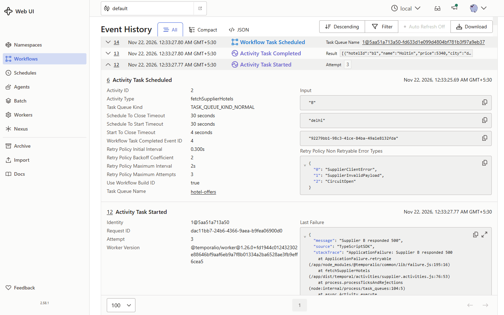
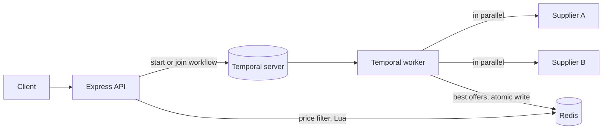
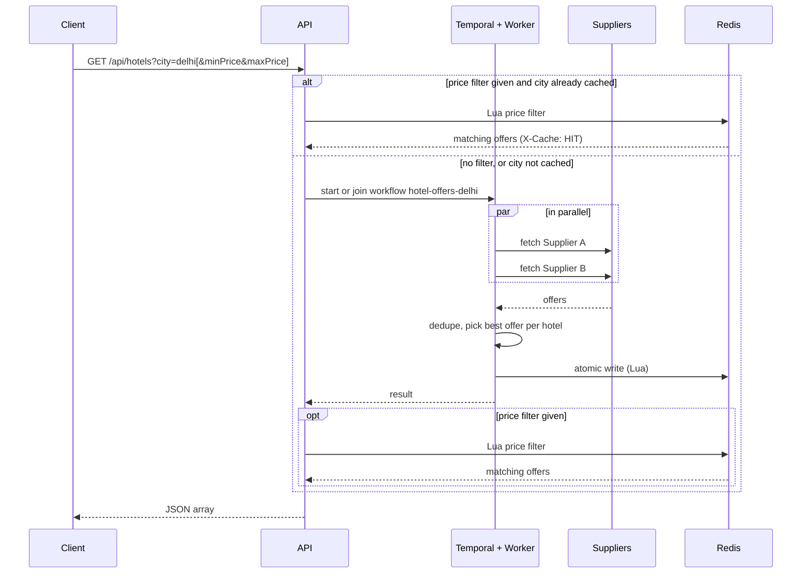

# Hotel Offer Orchestrator

[](https://github.com/Vanisha-vc5/hotel-offer-orchestrator/actions/workflows/ci.yml)
[](https://github.com/Vanisha-vc5/hotel-offer-orchestrator/actions/workflows/e2e.yml)

**A fault-tolerant hotel offer aggregator built with Node.js, TypeScript, Temporal and Redis.**

Hotel suppliers often list the same hotels at different prices. This service asks two suppliers in parallel,
removes duplicate hotels and returns the best offer for each one. Price filtering happens inside Redis.

I wanted to go beyond fetching two responses and comparing prices. The system also handles concurrent requests,
supplier failures, out-of-order cache updates and repeated supplier calls.

```
GET /api/hotels?city=delhi&minPrice=4000&maxPrice=6000
→ [{"name":"Holtin","price":5340,"supplier":"Supplier B","commissionPct":20},
   {"name":"Radison","price":5900,"supplier":"Supplier A","commissionPct":13}]
```

---

## Highlights

### 1. Orchestration with Temporal

Each request runs a Temporal workflow that calls both suppliers in parallel as activities. `Promise.all` could
also make parallel calls, but Temporal adds:

- retries with backoff and a timeout on every attempt, set as configuration rather than hand-written loops;
- a full history of every request in the Temporal UI, including each failed attempt;
- recovery if the worker crashes mid-request, without losing recorded progress.



### 2. Request coalescing

If 200 people ask for Delhi at the same moment, there's no need to call the suppliers 200 times. The workflow ID
is `hotel-offers-<city>`, so concurrent requests for the same city join the run that is already in progress.

**Benchmark, 200 concurrent requests (local laptop):**

| Metric         | Without coalescing | With coalescing |
| -------------- | -----------------: | --------------: |
| Workflow runs  |                200 |              12 |
| Supplier calls |                400 |              24 |
| p95 latency    |          11,276 ms |        2,354 ms |

That's 16.7× fewer supplier calls and about 4.8× faster p95 latency. Runs don't collapse to exactly one,
because the requests reach Temporal spread over time while a run lasts only about 150 ms. A request that
arrives after a run finishes starts a fresh one, so data is never stale. Full results are in
[docs/benchmarks.md](docs/benchmarks.md).

### 3. Atomic Redis caching and filtering

Each city is stored as three keys:

- a **sorted set** that indexes hotels by price;
- a **hash** with the offer details;
- a **metadata hash** with the cache and supplier status.

Both reads and writes are Lua scripts, so each one is a single atomic step:

- **Filtering** (`filterByPrice.lua`) runs `ZRANGEBYSCORE` and reads the matching offers in one call. Bounds
  are inclusive, and nothing is filtered in JavaScript.
- **Writes** (`writeCityOffers.lua`) carry a generation number. An older, slower workflow can't overwrite newer
  data, and a partial result never replaces a complete one that is still fresh.
- **Expiry:** complete results last 5 minutes and partial results 30 seconds. Empty cities are cached too, so
  they don't hit the suppliers every time.


### 4. Supplier failures

| Situation              | What you get                                                       |
| ---------------------- | ------------------------------------------------------------------ |
| Both suppliers up      | `200` with the best offers from both                               |
| One supplier down      | `200` with the other supplier's hotels, `X-Result-Status: partial` |
| Both suppliers down    | `503 SUPPLIERS_UNAVAILABLE`, not a misleading empty list           |
| Supplier slow or flaky | Retried up to 3 times, with a 4 s timeout per attempt              |
| Supplier keeps failing | A circuit breaker skips it, so responses come back in about 0.3 s  |

The circuit breaker is driven by a background Temporal workflow. It probes each supplier every 15 seconds and
opens after 3 failed probes.

### 5. Predictable offer selection

Names are matched after trimming, collapsing spaces and ignoring case, so `" Holtin "` and `"HOLTIN"` are the
same hotel. For each hotel:

1. The cheaper offer always wins.
2. On a price tie, the higher commission wins. The customer pays the same, and we earn more.
3. If price and commission are both equal, Supplier A wins, so results never change between runs.
4. A missing or invalid commission ranks lowest, so it can never win a tie.
5. Hotels offered by only one supplier are kept.

Similar-looking names, such as "Leela Palace" and "Pearl Palace", are never merged. Possible near-duplicates
are only reported in `/api/hotels/insights`.

---

## Running it

### Prerequisites

- **Docker Desktop** (Windows or macOS), or Docker Engine with the Compose plugin on Linux. It must be running.
- **Git.**
- These free ports: `3000` (API and console), `6379` (Redis), `7233` (Temporal) and `8080` (Temporal UI).

You don't need Node.js or an API key to run the demo.

### Start

```bash
git clone https://github.com/Vanisha-vc5/hotel-offer-orchestrator.git
cd hotel-offer-orchestrator
docker compose up -d --build --wait
```

The first run takes a few minutes while the images download and build. When the command returns, all six
services are healthy: the API, the worker, Temporal, the Temporal UI, Redis and PostgreSQL (used by Temporal).
You can check with `docker compose ps`.

| What                   | Where                                       |
| ---------------------- | ------------------------------------------- |
| Ops console (small UI) | http://localhost:3000/console               |
| Hotel API              | http://localhost:3000/api/hotels?city=delhi |
| API docs (Swagger)     | http://localhost:3000/docs                  |
| Health check           | http://localhost:3000/health                |
| Temporal UI            | http://localhost:8080                       |

To stop everything, run `docker compose down`. If a port is taken, copy `.env.example` to `.env` and change
`API_HOST_PORT`, `REDIS_HOST_PORT`, `TEMPORAL_HOST_PORT` or `TEMPORAL_UI_HOST_PORT`.

---

## Trying it out

The easiest way is the console at http://localhost:3000/console. You can search a city, filter by price and
switch a supplier off. Each result links to its workflow in the Temporal UI.


From a terminal (on Windows PowerShell, use `curl.exe` instead of `curl`):

```bash
curl -i "http://localhost:3000/api/hotels?city=delhi"                          # 7 hotels, details in the headers
curl "http://localhost:3000/api/hotels?city=delhi&minPrice=4000&maxPrice=6000" # filtered inside Redis
curl "http://localhost:3000/api/hotels?city=goa"                               # only Supplier A has goa
curl "http://localhost:3000/api/hotels?city=atlantis"                          # no hotels → []
```

Cities with data: `delhi`, `mumbai`, `bangalore`, `goa`, and `jaipur` (which has near-duplicate names for
`/api/hotels/insights`).

### Simulating supplier failures

Each supplier can be switched to `down`, `slow` or `flaky`:

```bash
curl -X POST http://localhost:3000/admin/chaos/suppliers/B \
  -H "content-type: application/json" -d '{"mode":"down"}'
curl -i "http://localhost:3000/api/hotels?city=delhi"   # still 200, Supplier A only, X-Result-Status: partial
curl -X DELETE http://localhost:3000/admin/chaos        # back to normal
```

[docs/DEMO_GUIDE.md](docs/DEMO_GUIDE.md) walks through every scenario, with the output you should see.

### Postman

1. Import `postman/HotelOfferOrchestrator.postman_collection.json` and `postman/local.postman_environment.json`.
2. Select the `local` environment.
3. Run the collection.

It covers the overlap city, price filtering, a city with no results, validation errors and supplier failures.
With Node 24, `npm ci` and then `npm run test:postman` runs it from the terminal.

---

## How it works



The API and the worker are separate processes built from the same Docker image:

- **API (Express):** validates the request and starts or joins the workflow. It also hosts the two mock
  suppliers, the console and the docs.
- **Worker:** runs the workflow. It calls both suppliers over HTTP, picks the best offers and saves them to
  Redis.



A request without a price filter always runs the workflow, so it always gets fresh data. A filtered request is
answered straight from Redis when the city is already cached.

---

## API

### `GET /api/hotels`

| Parameter  | Required | Notes                                                                 |
| ---------- | -------- | --------------------------------------------------------------------- |
| `city`     | yes      | letters, spaces and hyphens, up to 50 characters; case doesn't matter |
| `minPrice` | no       | number ≥ 0, inclusive                                                 |
| `maxPrice` | no       | number ≥ 0, inclusive, must be ≥ `minPrice`                           |

The response is a plain JSON array sorted by price, then name. Each item has exactly the four fields from the
assignment:

```json
[
  { "name": "Holtin", "price": 5340, "supplier": "Supplier B", "commissionPct": 20 },
  { "name": "Radison", "price": 5900, "supplier": "Supplier A", "commissionPct": 13 }
]
```

Everything else is in the response headers: `X-Suppliers-Status` (for example `A=up;B=down`),
`X-Result-Status` (`complete` or `partial`), `X-Cache` (`HIT` or `MISS`), `X-Workflow-Id` and `X-Request-Id`.

Errors always have the same shape:

```json
{
  "error": {
    "code": "SUPPLIERS_UNAVAILABLE",
    "message": "All suppliers are unavailable",
    "details": [],
    "requestId": "…"
  }
}
```

| Status | When                                                            |
| ------ | --------------------------------------------------------------- |
| 400    | missing or invalid `city`, invalid price, `minPrice > maxPrice` |
| 429    | too many requests                                               |
| 503    | both suppliers down, or Redis or Temporal unreachable           |
| 504    | the workflow took longer than 30 s                              |

### Other endpoints

- `GET /supplierA/hotels?city=…` and `GET /supplierB/hotels?city=…`: the mock suppliers.
- `GET /health`: checks both suppliers, Redis and Temporal. `/health/live` and `/health/ready` are for Docker.
- `GET /api/hotels/insights?city=…`: explains why each offer won, and lists possible near-duplicates.
- `/admin/*`: chaos switches and cache controls. Protected by `ADMIN_TOKEN` when one is set.
- `POST /api/hotels/ask`: **experimental** natural-language search, for example
  `{"query": "hotels in delhi under 6k"}`. A rules-based parser handles it by default, so no API key is needed.
  The optional LLM path is tested with mocked responses.

The full spec, with examples, is at http://localhost:3000/docs once the stack is running.

---

## Tests

The automated tests need Node 24 and a running Redis (`docker compose up -d redis`).

```bash
npm ci
npm test               # 310 tests: unit, Temporal workflow and integration (real Redis)
npm run lint
npm run typecheck
npm run test:postman   # the Postman collection, against the running stack
npm run verify         # all of the above on a fresh stack, plus failure scenarios
```

GitHub Actions runs CI and an end-to-end check on every push (see the badges at the top).

---

## Deployment

The project includes a production Compose override and scripts for a single Ubuntu 24.04 VM. Caddy provides
automatic HTTPS, and Redis, PostgreSQL and Temporal are not exposed to the internet.

On the VM:

```bash
curl -fsSL https://raw.githubusercontent.com/Vanisha-vc5/hotel-offer-orchestrator/main/deploy/setup-vm.sh -o setup-vm.sh
REPO_URL=https://github.com/Vanisha-vc5/hotel-offer-orchestrator.git PUBLIC_DOMAIN=<your-domain> bash setup-vm.sh
```

The script installs Docker, opens only ports 22, 80 and 443, creates `.env` with a random `ADMIN_TOKEN`, and
starts the stack with `docker-compose.prod.yml`. Without `PUBLIC_DOMAIN`, it uses `<public-ip>.sslip.io`. To
update later, run `bash deploy/update.sh`.

[docs/DEPLOYMENT.md](docs/DEPLOYMENT.md) covers VM sizing, DNS, logs, backups and troubleshooting.

---

## Configuration

It works without any configuration. Every setting has a default in `.env.example`. The ones you're most likely
to change:

| Variable                      | Default | What it does                          |
| ----------------------------- | ------: | ------------------------------------- |
| `CACHE_TTL_SECONDS`           |   `300` | how long complete results stay cached |
| `PARTIAL_CACHE_TTL_SECONDS`   |    `30` | how long partial results stay cached  |
| `SUPPLIER_RETRY_MAX_ATTEMPTS` |     `3` | attempts per supplier call            |
| `ENABLE_CHAOS`                |  `true` | the `/admin/chaos` switches           |
| `ADMIN_TOKEN`                 |   empty | if set, `/admin/*` needs this token   |

The full list is in [docs/CONFIGURATION.md](docs/CONFIGURATION.md).

## Project layout

```text
src/
  api/        Express app, routes, validation, error handling, OpenAPI
  domain/     offer selection and other pure logic (no I/O)
  infra/      config, logger, Redis repository, Lua scripts
  temporal/   workflows, activities, worker, client
  mocks/      supplier data and the chaos switches
  console/    the ops console (plain HTML, CSS and JS)
test/         unit, workflow and integration tests
postman/      Postman collection and environments
deploy/       VM setup and update scripts, Caddyfile
docs/         design notes, benchmarks, demo guide, deployment, configuration
```

## Limitations

- The suppliers are mocks. Real ones would need authentication, pagination and currency handling.
- It runs as a single instance. Several API replicas would need a shared rate-limit store and managed Redis and
  Temporal.
- Hotels are matched by exact name after cleanup. Near-duplicates such as "Radisson Blu" and "Radison Blu" are
  reported, never merged.
- The benchmark numbers come from one laptop, not a production load test.

More detail on the design decisions is in [docs/DESIGN_NOTES.md](docs/DESIGN_NOTES.md).
