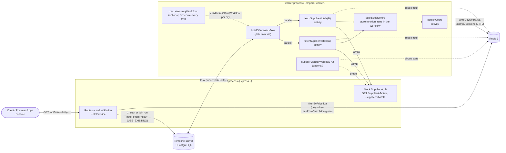
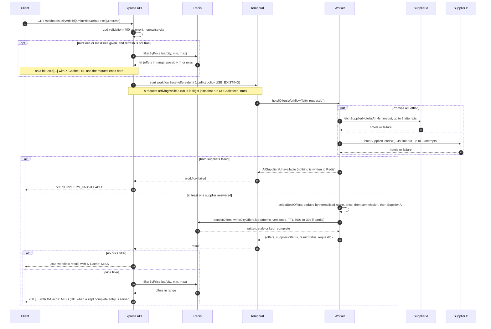
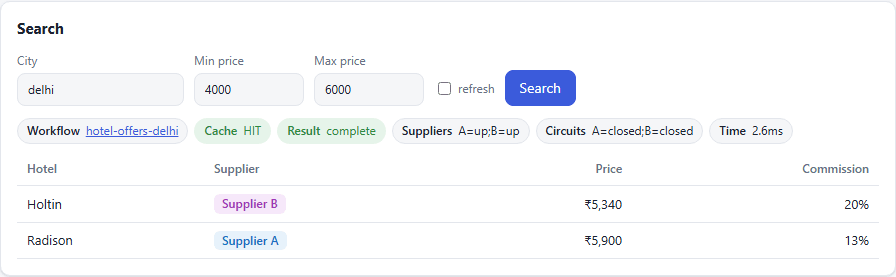
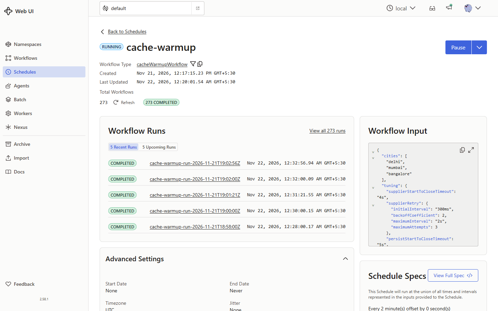
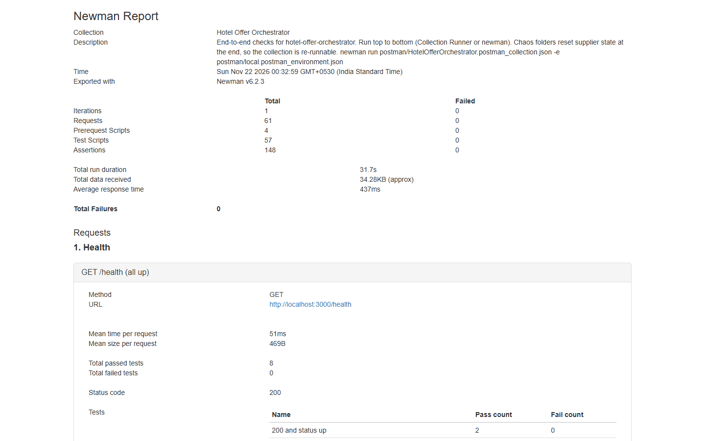

# Hotel Offer Orchestrator

[](https://github.com/Vanisha-vc5/hotel-offer-orchestrator/actions/workflows/ci.yml)
[](https://github.com/Vanisha-vc5/hotel-offer-orchestrator/actions/workflows/e2e.yml)


A hotel-offer aggregator. For a city, a **Temporal workflow** calls two suppliers in parallel, removes duplicate
hotels, and keeps the **best offer per hotel**. Results are stored in **Redis**, and price filtering runs
**inside Redis** in one Lua script. The API returns a bare JSON array of `{name, price, supplier, commissionPct}`.

```bash
cp .env.example .env && docker compose up --build -d --wait   # six healthy containers, ~1 min on first boot
curl -i "localhost:3000/api/hotels?city=delhi"                # the graded response
```

**Live demo:** _not deployed yet._ See [§20](#20-production-deployment).

## Contents

- **What and why:** [1 Overview](#1-project-overview) · [2 Problem](#2-problem-statement) ·
  [3 Features](#3-core-features) · [4 Stack](#4-technology-stack)
- **How it works:** [5 Architecture](#5-system-architecture) · [6 Request lifecycle](#6-request-lifecycle) ·
  [7 Temporal workflow](#7-temporal-workflow) · [8 Suppliers](#8-supplier-apis) ·
  [9 Offer selection](#9-deduplication-and-offer-selection) · [10 Redis cache](#10-redis-data-model-and-cache-strategy) ·
  [11 Lua filtering](#11-lua-based-price-filtering)
- **Resilience:** [12 Errors and partial failures](#12-error-handling-and-partial-supplier-failures) ·
  [13 Coalescing](#13-request-coalescing) · [14 Circuit breaker](#14-circuit-breaker)
- **Using it:** [15 API](#15-api-documentation) · [16 Docker](#16-docker-setup) ·
  [17 Environment variables](#17-environment-variables) · [18 Testing](#18-testing) ·
  [19 Benchmarks](#19-benchmark-results) · [20 Deployment](#20-production-deployment) ·
  [21 Limitations](#21-limitations-and-future-improvements)

More: [demo guide](docs/DEMO_GUIDE.md) · [design notes](docs/DESIGN_NOTES.md) ·
[configuration reference](docs/CONFIGURATION.md) · [deployment guide](docs/DEPLOYMENT.md) ·
[benchmarks](docs/benchmarks.md) · [verification report](docs/verification-report.md) ·
[changelog](CHANGELOG.md) · [original spec](docs/SPEC.md) · [build report](docs/BUILD_REPORT.md)

---

## 1. Project overview

Two Node.js processes are built from one Docker image:

- **api** (Express 5) validates requests, starts or joins workflows, reads Redis, and also hosts the two mock
  supplier APIs, `/health`, `/docs` (OpenAPI) and an ops console at `/console`.
- **worker** runs the Temporal workflows and activities. Activities call the suppliers over real HTTP, so
  latency, failures and timeouts are real.

Redis stores results, and Temporal (with PostgreSQL) stores workflow history. Everything starts with one
`docker compose up`.

## 2. Problem statement

The assignment asks for:

- an API that aggregates hotel offers for a city from two suppliers, orchestrated by a Temporal workflow that
  calls both in parallel;
- deduplication by hotel name, keeping the cheaper offer;
- storage of the result in Redis, with `minPrice`/`maxPrice` filtering done inside Redis;
- a fixed response format, mock supplier APIs, Docker, a Postman collection, and a README.

Bonus items are a `/health` endpoint that checks the suppliers, and logging and error handling.

The hard parts are what happens when a supplier is slow or down, when many identical requests arrive at once,
and when concurrent runs write the same Redis keys. This project answers each one explicitly.

## 3. Core features

**Required by the assignment.** Each row links to its code and the test that proves it. "PM n" is folder _n_ of
the [Postman collection](postman/HotelOfferOrchestrator.postman_collection.json).

| Requirement                                                        | Implemented in                                                                                                   | Proven by                                                                                                    |
| ------------------------------------------------------------------ | ---------------------------------------------------------------------------------------------------------------- | ------------------------------------------------------------------------------------------------------------ |
| Temporal workflow calls both suppliers **in parallel**             | [`hotelOffers.workflow.ts`](src/temporal/workflows/hotelOffers.workflow.ts)                                      | [workflow tests](test/workflow/hotelOffers.workflow.test.ts) · PM 3                                          |
| **Dedupe** by hotel name; **cheaper offer wins**                   | [`selectBestOffers.ts`](src/domain/selectBestOffers.ts)                                                          | [unit](test/unit/selectBestOffers.test.ts), [policy](test/unit/selection.policy.test.ts) tests · PM 3        |
| Save results to **Redis**                                          | [`hotelRepository.ts`](src/infra/hotelRepository.ts), [`writeCityOffers.lua`](src/infra/lua/writeCityOffers.lua) | [repository](test/integration/hotelRepository.test.ts), [cache policy](test/integration/cachePolicy.test.ts) |
| **Price filtering inside Redis**                                   | [`filterByPrice.lua`](src/infra/lua/filterByPrice.lua)                                                           | cache policy test (Redis `MONITOR` proves one `EVALSHA`) · PM 4                                              |
| Response: a bare array of `{name, price, supplier, commissionPct}` | [`hotels.routes.ts`](src/api/routes/hotels.routes.ts)                                                            | [contract guard](test/integration/contract.guard.test.ts) (byte-for-byte) · PM 3                             |
| Mock Supplier A and B APIs                                         | [`suppliers.routes.ts`](src/api/routes/suppliers.routes.ts), [`src/mocks/`](src/mocks)                           | PM 2                                                                                                         |
| One supplier down → partial result; both down → `503`              | workflow + [`errorHandler.ts`](src/api/middleware/errorHandler.ts)                                               | workflow tests · [cache API tests](test/integration/cacheApi.test.ts) · PM 7                                 |
| Docker, Postman (overlap city, empty city, supplier down)          | [`docker-compose.yml`](docker-compose.yml), [`postman/`](postman)                                                | `npm run verify` · PM 3–8                                                                                    |
| Bonus: `/health` checks both suppliers; logging; error handling    | [`healthService.ts`](src/api/services/healthService.ts), [`logger.ts`](src/infra/logger.ts)                      | [API tests](test/integration/api.test.ts) · PM 1, PM 7                                                       |

**Optional enhancements.** Each is additive and behind its own flag, and none changes the graded response.

- Request coalescing ([§13](#13-request-coalescing)).
- Supplier monitor workflows with a circuit breaker ([§14](#14-circuit-breaker)).
- A Temporal Schedule that warms the cache every 2 minutes.
- `GET /api/hotels/insights`, which explains each decision.
- Report-only near-duplicate detection.
- `POST /api/hotels/ask` natural-language search: a rules parser, with an LLM only if one is configured.
- An ops console with chaos controls.
- One-command verification, and HTTPS deployment with Caddy.

**The core needs no LLM and no API key:** the default is `LLM_PROVIDER=none`.

## 4. Technology stack

| Technology                    | Used for                        | Why it was chosen                                                                                                                                                                                                                                                                                                                                |
| ----------------------------- | ------------------------------- | ------------------------------------------------------------------------------------------------------------------------------------------------------------------------------------------------------------------------------------------------------------------------------------------------------------------------------------------------ |
| **Temporal** (TS SDK 1.26)    | orchestration                   | `Promise.all()` in a request handler gives parallelism, but no durable retries with backoff, per-attempt timeouts, crash recovery, or a record of what happened. Temporal declares retries and timeouts as policy, records every attempt in an inspectable history, resumes after a worker crash, and gives request coalescing via workflow IDs. |
| **Redis 7**                   | cache and server-side filtering | In-memory and fast. A sorted set gives `O(log n + m)` price-range queries, and Lua scripts make multi-key reads and writes atomic. Supplier chaos state and circuit state are shared through it, too.                                                                                                                                            |
| **Lua scripts**               | atomic read and write           | One round trip, no race between "is it cached?" and "read it", and filtering happens in Redis as required. The write script adds a version check that `MULTI` cannot express.                                                                                                                                                                    |
| **Express 5 + zod 4**         | HTTP API and validation         | Small and well known; Express 5 forwards async errors. zod validates every query, environment variable and supplier record from one schema.                                                                                                                                                                                                      |
| **pino**                      | structured logs                 | JSON logs with request and workflow IDs, and built-in redaction of secrets.                                                                                                                                                                                                                                                                      |
| **Docker Compose**            | local and production runtime    | Six services (PostgreSQL, Temporal, Temporal UI, Redis, api, worker) with health checks start in dependency order with one command, and evaluators need nothing but Docker.                                                                                                                                                                      |
| **Vitest, supertest, newman** | tests                           | Unit, Temporal workflow (time-skipping), and real-Redis integration tests; the Postman collection runs in CI through newman.                                                                                                                                                                                                                     |

## 5. System architecture

Solid lines are the required path. Dotted lines are optional features. Source:
[docs/diagrams/architecture.mmd](docs/diagrams/architecture.mmd).



The api never calls the suppliers for `/api/hotels` itself. Only workflow activities do. The api talks to
Redis directly only to run the price-filter script.

## 6. Request lifecycle

Source: [docs/diagrams/request-sequence.mmd](docs/diagrams/request-sequence.mmd). This matches
[`hotelService.ts`](src/api/services/hotelService.ts).



- **Without price parameters** the workflow always runs, so the response is always fresh, and the run also
  refreshes the cache.
- **With price parameters** the response always comes from Redis. If the city is not cached, or
  `refresh=true` is set, the workflow runs first.

## 7. Temporal workflow

[`hotelOffersWorkflow`](src/temporal/workflows/hotelOffers.workflow.ts):

1. Runs `fetchSupplierHotels('A')` and `fetchSupplierHotels('B')` with `Promise.allSettled`, so one failure
   cannot cancel the other.
2. Calls `selectBestOffers` inside the workflow. It is a pure function (no I/O, clocks or randomness, which
   ESLint enforces), so it is replay-safe.
3. Persists with the `persistOffers` activity, and returns
   `{offers, suppliersStatus, resultStatus, decisions, requestId}`.

| Setting                                      | Default                                 | Reason                                                                         |
| -------------------------------------------- | --------------------------------------- | ------------------------------------------------------------------------------ |
| supplier `startToCloseTimeout`               | 4 s (HTTP abort at 3.5 s)               | Bounds a hung supplier; the activity reports a typed `SupplierTimeout` itself. |
| supplier retry policy                        | 300 ms initial, ×2, max 2 s, 3 attempts | Rides out transient errors; a dead supplier costs about 2 s on this stack.     |
| non-retryable errors                         | 4xx, non-array payload, open circuit    | Retrying cannot fix them.                                                      |
| `persistOffers`                              | 5 s, 5 attempts                         | A Redis blip should not discard a good result.                                 |
| workflow execution timeout                   | 30 s                                    | A hard ceiling on how long a client can wait.                                  |
| start deadline (`TEMPORAL_START_TIMEOUT_MS`) | 5 s                                     | Returns `503` quickly when Temporal is unreachable, instead of hanging.        |

The values come from the environment. The API passes them in as workflow input, so they are recorded in
history. The workflow also answers a `status` query (`fetching → selecting → persisting → done`).


_Temporal UI, a real run with Supplier B set to `flaky`: B succeeded on attempt 3, the last failure was
"Supplier B responded 500", and the retry policy is visible._

## 8. Supplier APIs

`GET /supplierA/hotels?city=delhi` and `GET /supplierB/hotels?city=delhi` are mock suppliers served by the
api process. They return `[{hotelId, name, price, city, commissionPct}]`.

- The data covers `delhi` (the exact fixture from the brief), `mumbai`, `bangalore`, and `goa` (Supplier A
  only). Any other city returns `[]`.
- Mumbai has one deliberately malformed Supplier B record, and bangalore has a duplicate inside Supplier A.
  The activity validates every record with zod, drops bad ones with a log line, and keeps the rest.
- With `ENABLE_CHAOS=true`, each supplier can be switched to `down` (503), `slow` (delay beyond the timeout)
  or `flaky` (fails twice, then succeeds) through `/admin/chaos`. The state lives in Redis, so the api and
  worker share it.

## 9. Deduplication and offer selection

[`selectBestOffers`](src/domain/selectBestOffers.ts) groups offers by a **normalised name key** and picks one
winner per hotel:

1. **Lower price wins.** Always: commission can never beat a cheaper price.
2. On an equal price, the **higher `commissionPct`** wins: the customer pays the same, and the margin is better.
3. If both are equal, **Supplier A** wins, so the result is deterministic.

**Normalisation** (`normalizeHotelName`): Unicode NFC, trim, collapse whitespace (including non-breaking spaces),
lowercase. `"  The Grand  Hotel "`, `"THE GRAND HOTEL"` and `"The Grand Hotel"` are one hotel. Names that are
merely similar ("Leela Palace" and "Pearl Palace") stay separate. Duplicates inside one supplier keep that
supplier's cheapest offer. Hotels offered by only one supplier are kept.

**Invalid data:**

- A missing, `null`, non-numeric, `NaN`, infinite or negative commission ranks **lowest** in the tie-break. It
  never beats a valid commission and never affects the price comparison. It is returned as `commissionPct: 0`.
- An offer with an invalid price or an empty name is skipped.

Each decision is recorded as `cheaper`, `tie_higher_commission`, `tie_default` or `single_source`, and
`GET /api/hotels/insights` shows it.

Fuzzy matching ("Radisson Blu" ≈ "Radison Blu") is a separate, **report-only** feature in insights. It never
merges hotels or changes the selection. See [design notes](docs/DESIGN_NOTES.md).

## 10. Redis data model and cache strategy

Three keys per city. The `{city}` hash tag keeps them in one Redis Cluster slot.

| Key                      | Type | Content                                                                                                                              |
| ------------------------ | ---- | ------------------------------------------------------------------------------------------------------------------------------------ |
| `hotels:{city}:by_price` | ZSET | member = normalised name, score = price                                                                                              |
| `hotels:{city}:offers`   | HASH | normalised name → the 4-key offer JSON                                                                                               |
| `hotels:{city}:meta`     | HASH | `generation`, `fetchedAt`, `workflowId`, `runId`, `requestId`, `count`, `suppliersStatus`, `resultStatus`, `ttlSeconds`, `decisions` |

**Write policy** ([`writeCityOffers.lua`](src/infra/lua/writeCityOffers.lua), one atomic script):

| Situation                                                 | Outcome                                                                                    |
| --------------------------------------------------------- | ------------------------------------------------------------------------------------------ |
| newer or equal `generation` (the run's start time)        | `written`: all three keys are replaced (removed hotels disappear), with a TTL on every key |
| older `generation` than the cached one (a late, slow run) | `stale`: ignored, so the cache never rolls back                                            |
| partial result while a **complete** entry is still valid  | `kept_complete`: the complete data is kept, and its TTL is not extended                    |
| partial result and no cached entry                        | `written`, with the short partial TTL                                                      |
| both suppliers down                                       | nothing is written; the workflow fails before persisting                                   |

- **TTL:** complete results live for `CACHE_TTL_SECONDS` (300 s). Partial results live for
  `PARTIAL_CACHE_TTL_SECONDS` (30 s), so the cache heals quickly after a supplier recovers. All three keys
  expire together.
- **Three cache states:** _miss_ (no meta key), _cached empty_ (meta with `count: 0`, served as a `HIT` with
  `[]`, so no repeated supplier calls), and _cached non-empty_.
- **Invalidation:** every unfiltered request and every warm-up tick (optional) refresh the city;
  `DELETE /admin/cache/:city` clears it; price changes, new hotels and removed hotels all arrive through a full
  replacement.

The response for **that** request is unchanged: an unfiltered request still returns its own partial result. A
filtered request reads Redis, so its headers always describe the data actually served.

## 11. Lua-based price filtering

[`filterByPrice.lua`](src/infra/lua/filterByPrice.lua) runs as one `EVALSHA`:

1. `EXISTS meta`. If it is missing, the result is a miss.
2. `ZRANGEBYSCORE by_price min max`, inclusive at both ends; a missing bound is `-inf` or `+inf`.
3. `HMGET offers …` for the matching names.

The result is already sorted by `(price, name)`, and no filtering happens in JavaScript. A test watches Redis
`MONITOR` and asserts that exactly one script call is made and that `ZRANGEBYSCORE` runs inside it.



_Ops console, real run: `delhi` with `minPrice=4000&maxPrice=6000` served from the cache by the Lua script
(`Cache HIT`, 2.4 ms)._

## 12. Error handling and partial supplier failures

| Situation                        | Response                                                                                              |
| -------------------------------- | ----------------------------------------------------------------------------------------------------- |
| one supplier fails after retries | `200` with the other supplier's hotels, `X-Result-Status: partial`, `X-Suppliers-Status: A=up;B=down` |
| both suppliers fail              | `503 SUPPLIERS_UNAVAILABLE`, never `[]`, which would wrongly claim there are no hotels                |
| unknown city                     | `200 []` (cached as an empty result)                                                                  |
| a malformed supplier record      | that record is dropped and logged; the rest are kept                                                  |

Every error has one shape, and stack traces appear only in development:

```json
{
  "error": {
    "code": "VALIDATION_ERROR",
    "message": "Invalid request",
    "details": [{ "path": "minPrice", "message": "minPrice must be <= maxPrice" }],
    "requestId": "fb24492e-d4a7-4a90-a813-43e0f799e51e"
  }
}
```

**Observability.** Logs are structured pino JSON. One `X-Request-Id` follows a request through Express, the
workflow memo, every activity log line, and the Redis meta (`requestId`). The log lines include:

- `workflow started or joined` and `workflow completed`, with workflow ID and type, duration, and `coalesced`.
- Per-supplier `supplier fetched` lines, with `latencyMs`, `attempt` and record counts.
- `hotelsFromA`, `hotelsFromB` and `afterDedup`.
- `offers persisted` or `cache write skipped`, with the outcome.
- `hotels served`, with `cache` and `filterMs`.
- `circuit state changed`.

When a request joins another request's run, the log keeps both the current `requestId` and the
`originRequestId`. Admin tokens, auth headers, cookies and API keys are redacted, and a unit test checks
this.

## 13. Request coalescing

**Why:** a burst of identical requests ("delhi", 100 times) should not call the suppliers 100 times.

The workflow ID is deterministic (`hotel-offers-<city>`) and is started with
`workflowIdConflictPolicy: USE_EXISTING`. While a run is in flight, new requests **join** it, and once it
closes, the next request starts a fresh run (`ALLOW_DUPLICATE`), so data is never stale. Joined responses
share `X-Workflow-Run-Id` and carry `X-Coalesced: true`.

```text
$ npm run demo:coalescing        # real output
20 concurrent requests in 2099ms
distinct runs: 1  01a1ff77-db9c-7080-af45-5c922349d006
PASS: all 20 requests shared one workflow execution
```

## 14. Circuit breaker

**Why:** without one, every request to a dead supplier waits through about 2 s of retries before returning a
partial result.

- Two long-running `supplierMonitorWorkflow`s probe each supplier every 15 s, on a durable timer, and
  continue-as-new every 100 iterations.
- 3 consecutive failed probes **open** the circuit. After a 30 s cooldown, one probe runs half-open: success
  closes the circuit, failure re-opens it.
- While a circuit is open, `fetchSupplierHotels` fails fast with a non-retryable `CircuitOpen`. The request
  is a normal partial result, plus `X-Circuit-State: A=closed;B=open`.
- The breaker is driven by probes, not by user traffic, so it behaves the same under no load and under heavy
  load.

In one real run with B down, a request took **2201 ms** before the circuit opened and **273 ms** after.

## 15. API documentation

Interactive docs: **<http://localhost:3000/docs>**. The raw spec is at `/openapi.json`, and a
[drift test](test/integration/openapi.drift.test.ts) keeps it in sync with the routes, examples and headers.

### `GET /api/hotels`

| Parameter  | Required | Rules                                                                          |
| ---------- | -------- | ------------------------------------------------------------------------------ |
| `city`     | yes      | trimmed, lowercased; letters (any script), spaces and hyphens; 1–50 characters |
| `minPrice` | no       | finite number ≥ 0, inclusive                                                   |
| `maxPrice` | no       | finite number ≥ 0, inclusive; must be ≥ `minPrice`                             |
| `refresh`  | no       | `true` or `false`; with a price filter, forces a workflow run first            |

```http
GET /api/hotels?city=delhi

HTTP/1.1 200 OK
X-Request-Id: daef26cf-50f8-4a84-879f-3effc4a53ac1
X-Workflow-Id: hotel-offers-delhi
X-Workflow-Run-Id: 01a1f9e0-afc4-7796-9286-88169dbcb240
X-Suppliers-Status: A=up;B=up
X-Result-Status: complete
X-Cache: MISS
X-Coalesced: false
X-Circuit-State: A=closed;B=closed
X-Response-Time: 316.2ms

[{"name":"Ibis","price":2900,"supplier":"Supplier B","commissionPct":9},
 {"name":"Lemon Tree","price":3200,"supplier":"Supplier A","commissionPct":8},
 {"name":"Holtin","price":5340,"supplier":"Supplier B","commissionPct":20},
 {"name":"Radison","price":5900,"supplier":"Supplier A","commissionPct":13},
 {"name":"Hyatt Regency","price":8400,"supplier":"Supplier B","commissionPct":16},
 {"name":"The Leela","price":9800,"supplier":"Supplier A","commissionPct":12},
 {"name":"Taj Palace","price":11900,"supplier":"Supplier B","commissionPct":18}]
```

```bash
curl "localhost:3000/api/hotels?city=delhi&minPrice=4000&maxPrice=6000"
# [{"name":"Holtin","price":5340,...},{"name":"Radison","price":5900,...}]      X-Cache: HIT
curl "localhost:3000/api/hotels?city=delhi&minPrice=5340&maxPrice=5340"   # [Holtin] (bounds are inclusive)
curl "localhost:3000/api/hotels?city=atlantis"                            # 200 []
```

The body is always exactly the four keys. All metadata travels in the `X-*` headers, which are documented in
`/docs`. `X-Coalesced` appears only on workflow-backed responses, and `X-Circuit-State` only when the monitor
is enabled.

### Other endpoints

| Endpoint                                         | Purpose                                                                                                            |
| ------------------------------------------------ | ------------------------------------------------------------------------------------------------------------------ |
| `GET /supplierA/hotels`, `GET /supplierB/hotels` | mock suppliers (`?city=` optional)                                                                                 |
| `GET /health`                                    | both suppliers, Redis and Temporal, probed in parallel: `200 up`, `200 degraded` (one supplier down) or `503 down` |
| `GET /health/live`, `GET /health/ready`          | liveness (always 200), and readiness (Redis and Temporal; `503` while draining)                                    |
| `GET /api/hotels/insights?city=`                 | optional: the decision log (both offers, winner, reason, savings) and possible duplicates                          |
| `POST /api/hotels/ask` `{"query": "…"}`          | optional: natural-language search, e.g. "hotels in delhi under 6k"                                                 |
| `/admin/*`                                       | chaos, cache clearing, circuits, warm-up and metrics; needs `x-admin-token` when `ADMIN_TOKEN` is set              |
| `GET /console`, `GET /docs`                      | ops console and Swagger UI                                                                                         |

### Status codes

| HTTP | Code                    | When                                                                               |
| ---- | ----------------------- | ---------------------------------------------------------------------------------- |
| 200  |                         | success (possibly `[]`, or partial with `X-Result-Status: partial`)                |
| 400  | `VALIDATION_ERROR`      | missing or invalid `city`, invalid price, `minPrice > maxPrice`, unknown parameter |
| 401  | `UNAUTHORIZED`          | `/admin/*` without a valid `x-admin-token`                                         |
| 404  | `NOT_FOUND`             | unknown route                                                                      |
| 422  | `UNPROCESSABLE_QUERY`   | `/api/hotels/ask` could not find a city in the query                               |
| 429  | `RATE_LIMITED`          | more than `RATE_LIMIT_MAX` requests per window on `/api`                           |
| 502  | `WORKFLOW_FAILED`       | the workflow failed for an unexpected reason                                       |
| 503  | `SUPPLIERS_UNAVAILABLE` | both suppliers failed after retries                                                |
| 503  | `TEMPORAL_UNAVAILABLE`  | Temporal unreachable (within `TEMPORAL_START_TIMEOUT_MS`)                          |
| 503  | `REDIS_UNAVAILABLE`     | Redis unreachable                                                                  |
| 504  | `WORKFLOW_TIMEOUT`      | the workflow exceeded 30 s                                                         |


_The ops console at `/console`: search, natural-language ask, live supplier health and circuits, chaos
controls, and insights._

## 16. Docker setup

**Prerequisite:** Docker with Compose v2. Node 24 (see `.nvmrc`) is needed only for tests and scripts.

```bash
cp .env.example .env
docker compose up --build -d --wait     # postgresql, temporal, temporal-ui, redis, api, worker → healthy
docker compose ps
```

- API: <http://localhost:3000> · Swagger UI: <http://localhost:3000/docs> · console: <http://localhost:3000/console>
- Temporal UI: <http://localhost:8080>, where workflow `hotel-offers-delhi` appears after the first request.

One multi-stage, non-root image runs both `api` and `worker`. Every service has a health check, and the api and
worker start only once Temporal's namespace exists. For local development without containerising the app,
run `docker compose up -d redis temporal temporal-ui`, then `npm run dev:api` and `npm run dev:worker`.



_The optional `cache-warmup` Temporal Schedule, running every 2 minutes in the local stack._

## 17. Environment variables

**Local development needs no variables:** every value has a safe default in `.env.example`.

**Required in production** (`docker-compose.prod.yml`; Compose refuses to start without them):

| Variable        | Purpose                                                                        |
| --------------- | ------------------------------------------------------------------------------ |
| `ADMIN_TOKEN`   | 16+ characters; protects `/admin/*` (generated by `deploy/setup-vm.sh`)        |
| `PUBLIC_DOMAIN` | the hostname Caddy gets an HTTPS certificate for (a domain or `<ip>.sslip.io`) |

**Commonly changed (optional):**

| Variable                                                                                                          | Default        | Effect                                                      |
| ----------------------------------------------------------------------------------------------------------------- | -------------- | ----------------------------------------------------------- |
| `CACHE_TTL_SECONDS` / `PARTIAL_CACHE_TTL_SECONDS`                                                                 | `300` / `30`   | cache lifetime for complete and partial results             |
| `SUPPLIER_ACTIVITY_TIMEOUT` / `SUPPLIER_RETRY_MAX_ATTEMPTS`                                                       | `4s` / `3`     | per-attempt timeout and retry count                         |
| `WORKFLOW_EXECUTION_TIMEOUT`                                                                                      | `30s`          | hard limit per request                                      |
| `REDIS_URL`, `TEMPORAL_ADDRESS`, `TEMPORAL_NAMESPACE`                                                             | local services | infrastructure endpoints (Temporal Cloud is supported)      |
| `ENABLE_CHAOS`                                                                                                    | `true`         | failure injection under `/admin/chaos`                      |
| `FEATURE_MONITOR`, `FEATURE_WARMUP`, `FEATURE_ASK`, `FEATURE_DUPLICATES`, `FEATURE_CONSOLE`, `COALESCING_ENABLED` | `true`         | turn optional features off                                  |
| `LLM_PROVIDER`                                                                                                    | `none`         | `anthropic` or `openai-compatible` enables the optional LLM |

The full list, with every default, is in [docs/CONFIGURATION.md](docs/CONFIGURATION.md). All values are
validated by zod at startup, and an invalid value stops the process with a clear message.

## 18. Testing

```bash
docker compose up -d redis            # integration tests use a real Redis (DB 15)
npm run lint && npm run typecheck
npm test                              # unit + workflow + integration (Vitest)
npm run test:postman                  # Postman collection via newman (needs the full stack)
npm run verify                        # clean stack → lint, types, tests, newman, chaos, benchmark → report
```

| Suite                         | Covers                                                                                                                                                                               |
| ----------------------------- | ------------------------------------------------------------------------------------------------------------------------------------------------------------------------------------ |
| `test/unit` (11 files)        | selection and tie-break rules, invalid commission and price, name normalisation, activity HTTP behaviour (real stub server), config, log redaction, parsers                          |
| `test/workflow` (5 files)     | happy path, partial and total failure, retries, the status query, coalescing on a real Temporal dev server, monitors, warm-up Schedule                                               |
| `test/integration` (16 files) | Lua filtering and boundaries, the three cache states, TTL expiry, versioned and concurrent writes, partial-result policy, the HTTP contract byte-for-byte, OpenAPI drift, admin auth |

**Latest results** on this machine: 309 Vitest tests passed in 32 files; lint and typecheck clean; Postman: 61
requests and 148 assertions, 0 failures, run twice in a row against the same stack. The
[verification report](docs/verification-report.md) is generated by `npm run verify`.



_The Postman collection run by newman against the local stack (official HTML reporter): 61 requests, 148
assertions, 0 failed._

## 19. Benchmark results

`npm run benchmark` fires N simultaneous `GET /api/hotels?city=delhi` requests, with coalescing on and off.
These numbers are from one laptop running every service in Docker
([full table and machine details](docs/benchmarks.md)). Treat the ratios as the result, not the absolute
latencies.

|   N | coalescing | workflow runs | supplier calls |      p95 |
| --: | ---------- | ------------: | -------------: | -------: |
| 100 | on         |             6 |             12 |  1236 ms |
| 100 | off        |           100 |            200 |  4607 ms |
| 200 | on         |            12 |             24 |  2354 ms |
| 200 | off        |           200 |            400 | 11276 ms |

Runs don't collapse to exactly one, because the burst reaches Temporal spread over time while a run lasts
only about 150 ms. A request that arrives after a run closes correctly starts a fresh one.

## 20. Production deployment

`deploy/setup-vm.sh` deploys to one Linux VM in one command:

- installs Docker and sets up the ufw firewall (22, 80, 443);
- generates secrets;
- starts the stack with `docker-compose.prod.yml`:
  - Caddy with Let's Encrypt HTTPS, and only Caddy publishes public ports (the Temporal UI is loopback only);
  - `ADMIN_TOKEN` required, and the coalescing override and open `/admin` both off;
  - `LLM_PROVIDER=none`;
  - log rotation and memory limits.

```bash
REPO_URL=https://github.com/Vanisha-vc5/hotel-offer-orchestrator.git PUBLIC_DOMAIN=<domain or ip.sslip.io> \
  bash deploy/setup-vm.sh
npm run smoke -- --url https://<domain>   # checks health, the delhi contract, filtering, /console and /docs
```

Updates use `deploy/update.sh`. [docs/DEPLOYMENT.md](docs/DEPLOYMENT.md) covers the following:

- Windows (PowerShell) commands, backups and troubleshooting.
- Plain Compose, nginx and Temporal Cloud alternatives.

## 21. Limitations and future improvements

- **Single instance.** The rate-limit store is in memory, and Redis and Temporal run as single containers.
  Several API replicas would need a Redis-backed rate-limit store, Redis Sentinel or Cluster (the keys are
  already cluster-safe), and a managed Temporal (Temporal Cloud is supported through configuration).
- **No metrics backend.** Observability is structured logs plus the Temporal UI. An OpenTelemetry
  interceptor that exports traces and metrics would be the next step.
- **Benchmarks** come from one laptop and are not a capacity claim.
- **Mock suppliers only.** A real adapter layer (auth, pagination, currencies) would sit behind the same
  activity interface.
- **Exact-name dedupe** is by design. Near-duplicates are only reported; real merging needs shared property
  IDs or human review.
- **Stale-while-revalidate** (serve the last good result while a refresh runs) is not implemented. The
  unfiltered endpoint always waits for a fresh run, as the brief requires.
- **Large cities:** `HMGET` returns every matching hotel at once. There is no pagination, which is fine for
  thousands of hotels per city.
