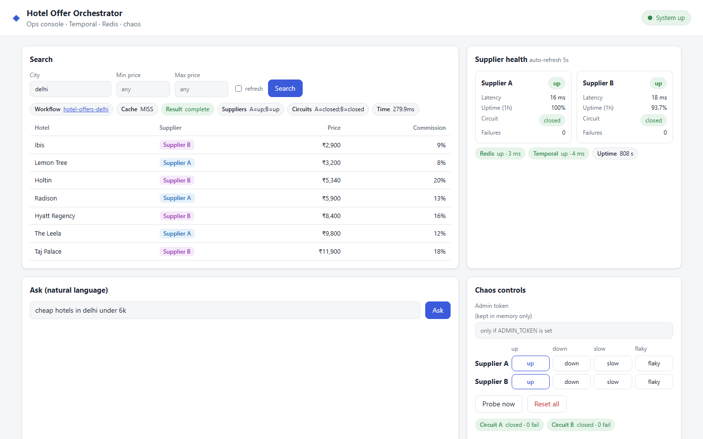
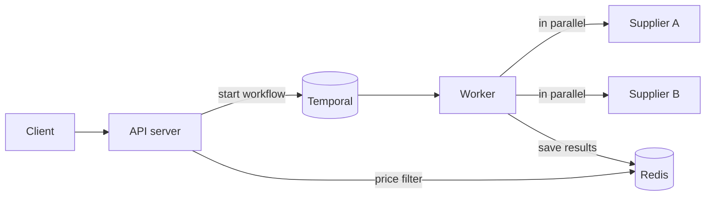
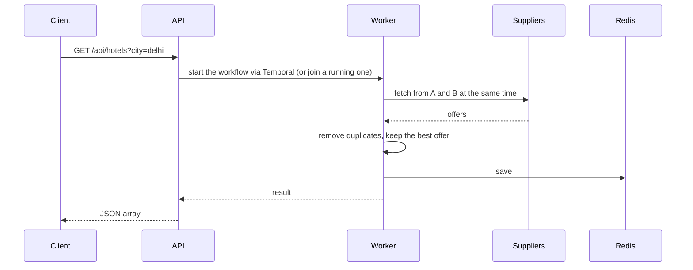

# Hotel Offer Orchestrator

[](https://github.com/Vanisha-vc5/hotel-offer-orchestrator/actions/workflows/ci.yml)
[](https://github.com/Vanisha-vc5/hotel-offer-orchestrator/actions/workflows/e2e.yml)

You give it a city, and it asks two hotel suppliers for offers, merges the duplicates and returns the best
offer for each hotel. The supplier calls run inside a Temporal workflow, and the results are stored in Redis,
where price filtering also happens.

```
GET /api/hotels?city=delhi&minPrice=4000&maxPrice=6000
→ [{"name":"Holtin","price":5340,"supplier":"Supplier B","commissionPct":20},
   {"name":"Radison","price":5900,"supplier":"Supplier A","commissionPct":13}]
```

Built with Node.js 24, TypeScript, Express, Temporal, Redis and Docker.

---

## Running it

You only need **Docker Desktop**. Everything else, including both suppliers, runs inside containers.

```bash
git clone https://github.com/Vanisha-vc5/hotel-offer-orchestrator.git
cd hotel-offer-orchestrator
docker compose up -d --build --wait
```

The first run takes a couple of minutes while the images build. When the command returns, all six containers
are healthy. You can check with `docker compose ps`.

Then open:

| What                     | Where                                       |
| ------------------------ | ------------------------------------------- |
| Ops console (a small UI) | http://localhost:3000/console               |
| The API                  | http://localhost:3000/api/hotels?city=delhi |
| API docs (Swagger)       | http://localhost:3000/docs                  |
| Health check             | http://localhost:3000/health                |
| Temporal UI (workflows)  | http://localhost:8080                       |

To stop everything, run `docker compose down`.

> **Port already in use?** Copy `.env.example` to `.env` and change `API_HOST_PORT`, `REDIS_HOST_PORT`,
> `TEMPORAL_HOST_PORT` or `TEMPORAL_UI_HOST_PORT`.
>
> **On Windows PowerShell,** use `curl.exe` rather than `curl` for the commands below.

## Trying it out

The easiest way is the console at http://localhost:3000/console. You can search a city, filter by price, switch
a supplier off and see what happens. Each result links to its workflow in the Temporal UI.



From a terminal:

```bash
curl -i "localhost:3000/api/hotels?city=delhi"                           # 7 hotels, details in the headers
curl "localhost:3000/api/hotels?city=delhi&minPrice=4000&maxPrice=6000"  # filtered inside Redis
curl "localhost:3000/api/hotels?city=goa"                                # only Supplier A has goa
curl "localhost:3000/api/hotels?city=atlantis"                           # no hotels → []
```

Cities with data: `delhi`, `mumbai`, `bangalore` and `goa`.

**Breaking things on purpose.** Each supplier can be switched to `down`, `slow` or `flaky`:

```bash
curl -X POST localhost:3000/admin/chaos/suppliers/B -H "content-type: application/json" -d '{"mode":"down"}'
curl -i "localhost:3000/api/hotels?city=delhi"   # still 200, Supplier A's hotels only, X-Result-Status: partial
curl -X DELETE localhost:3000/admin/chaos        # everything back to normal
```

If both suppliers are down you get a `503`, not an empty list. An empty list would wrongly say the city has no
hotels. [docs/DEMO_GUIDE.md](docs/DEMO_GUIDE.md) walks through every scenario, with the output you should see.

**Postman.** Import `postman/HotelOfferOrchestrator.postman_collection.json` and
`postman/local.postman_environment.json`, select the `local` environment and run the collection. It covers the
normal case, filtering, an empty city, validation errors and supplier failures. If you have Node 24, run
`npm ci` and then `npm run test:postman` to do the same from the terminal.

## How it works



There are two processes, built from the same Docker image:

- **api**: the Express server. It validates the request and starts the workflow. It also hosts the two mock
  suppliers, the console and the docs.
- **worker**: runs the Temporal workflow. It calls both suppliers over HTTP in parallel, picks the best offers
  and saves them to Redis.

A single request looks like this:



When `minPrice` or `maxPrice` is given, the API asks Redis first. If the city is already cached, it answers
straight from Redis without running the workflow (`X-Cache: HIT`). Otherwise it runs the workflow first.

### Picking the best offer

Hotels are matched by name, ignoring case and extra spaces. `" Holtin "` and `"HOLTIN"` are the same hotel,
but similar-looking names like "Leela Palace" and "Pearl Palace" are kept apart. For each hotel:

1. The cheaper offer wins.
2. If the price is the same, the higher commission wins. The customer pays the same, and we earn more.
3. If both are the same, Supplier A wins, so the result never changes between runs.

Hotels offered by only one supplier are kept. A missing or broken commission value counts as the lowest, so it
can never win a tie, and a cheaper price always wins regardless of commission.

### Why Temporal and not just `Promise.all`

`Promise.all` would fetch both suppliers in parallel too. Temporal also gives you:

- retries with backoff and per-attempt timeouts, as configuration rather than hand-written loops;
- a full history of every request in the UI, including each failed attempt;
- recovery if the worker crashes mid-request.

It also makes **request coalescing** easy. The workflow ID is `hotel-offers-<city>`, so if 20 people ask for
delhi at the same moment, they all share one workflow, and the suppliers are called once instead of 20 times.
With Node 24 installed, `npm ci` and then `npm run demo:coalescing` shows this.


### Redis and the cache

Each city is stored as three keys: a sorted set of hotel names scored by price, a hash with the offers, and a
hash with metadata.

- **Price filter.** It is one Lua script, `filterByPrice.lua`. It uses `ZRANGEBYSCORE` on the sorted set and
  then reads the matching offers. Both bounds are inclusive, and nothing is filtered in JavaScript.
- **Writes.** They also go through a Lua script, `writeCityOffers.lua`, so they are atomic:
  - a slower, older workflow can't overwrite newer data;
  - a partial result (one supplier down) doesn't replace a complete one that is still fresh.
- **Expiry.** Complete results expire after 5 minutes and partial ones after 30 seconds. A city with no hotels
  is cached too, so it doesn't hit the suppliers every time.

### When suppliers fail

| Situation                | What you get                                                       |
| ------------------------ | ------------------------------------------------------------------ |
| One supplier down        | `200` with the other supplier's hotels, `X-Result-Status: partial` |
| Both down                | `503 SUPPLIERS_UNAVAILABLE`                                        |
| Supplier slow or flaky   | retried up to 3 times with a 4 s timeout per attempt               |
| A supplier keeps failing | the circuit breaker skips it until it recovers                     |

The circuit breaker is driven by a small background workflow that probes each supplier every 15 seconds. After
3 failed probes it opens, and requests skip that supplier straight away: about 0.3 s, instead of about 2 s spent
on retries.

## API

### `GET /api/hotels`

| Parameter  | Required | Notes                                                                 |
| ---------- | -------- | --------------------------------------------------------------------- |
| `city`     | yes      | letters, spaces and hyphens, up to 50 characters; case doesn't matter |
| `minPrice` | no       | number ≥ 0, inclusive                                                 |
| `maxPrice` | no       | number ≥ 0, inclusive, must be ≥ `minPrice`                           |

The response is a plain JSON array sorted by price, then name. Each item has exactly four fields:

```json
[
  { "name": "Ibis", "price": 2900, "supplier": "Supplier B", "commissionPct": 9 },
  { "name": "Lemon Tree", "price": 3200, "supplier": "Supplier A", "commissionPct": 8 }
]
```

Everything else goes in the response headers:

- `X-Suppliers-Status`, for example `A=up;B=down`
- `X-Result-Status`: `complete` or `partial`
- `X-Cache`: `HIT` or `MISS`
- `X-Workflow-Id`, and `X-Request-Id` for tracing in the logs

Errors always look like `{"error": {"code", "message", "details", "requestId"}}`:

| Status | When                                                           |
| ------ | -------------------------------------------------------------- |
| 400    | bad or missing `city`, invalid price, or `minPrice > maxPrice` |
| 429    | too many requests                                              |
| 503    | both suppliers down, or Redis or Temporal unreachable          |
| 504    | the workflow took longer than 30 s                             |

### Other endpoints

- `GET /supplierA/hotels?city=…` and `GET /supplierB/hotels?city=…` are the mock suppliers.
- `GET /health` checks both suppliers, Redis and Temporal. `/health/live` and `/health/ready` are for Docker.
- `GET /api/hotels/insights?city=…` explains why each offer won.
- `/admin/*` holds the chaos switches and cache controls. It is protected by `ADMIN_TOKEN` when one is set.
- `POST /api/hotels/ask` is natural-language search, such as `{"query": "hotels in delhi under 6k"}`. It is
  **experimental**: the LLM path is tested with mocks, and by default a simple rules parser handles it. No API
  key is needed.

The full spec, with examples, is at http://localhost:3000/docs.

## Tests

The tests need Node 24 and a running Redis (`docker compose up -d redis`).

```bash
npm ci
npm test               # 309 tests: unit, Temporal workflow and integration (real Redis)
npm run lint
npm run typecheck
npm run test:postman   # the Postman collection, against the running stack
npm run verify         # everything above on a fresh stack, plus failure scenarios
```

GitHub Actions runs the same checks on every push (see the badges at the top).

## Configuration

It works without any configuration. Every setting has a default in `.env.example`. The ones you're most
likely to touch:

| Variable                      | Default | What it does                          |
| ----------------------------- | ------- | ------------------------------------- |
| `CACHE_TTL_SECONDS`           | `300`   | how long complete results stay cached |
| `PARTIAL_CACHE_TTL_SECONDS`   | `30`    | how long partial results stay cached  |
| `SUPPLIER_RETRY_MAX_ATTEMPTS` | `3`     | attempts per supplier call            |
| `ENABLE_CHAOS`                | `true`  | the `/admin/chaos` switches           |
| `ADMIN_TOKEN`                 | empty   | if set, `/admin/*` needs this token   |

The full list is in [docs/CONFIGURATION.md](docs/CONFIGURATION.md). To deploy to a server with HTTPS, see
[docs/DEPLOYMENT.md](docs/DEPLOYMENT.md).

## Project layout

```
src/
  api/          Express app, routes, validation, error handling, OpenAPI
  domain/       selectBestOffers and other pure logic (no I/O)
  infra/        config, logger, Redis repository, Lua scripts
  temporal/     workflows, activities, worker, client
  mocks/        supplier data and the chaos switches
  console/      the ops console (plain HTML/CSS/JS)
test/           unit, workflow and integration tests
postman/        Postman collection and environment
docs/           demo guide, design notes, config, deployment, benchmarks
```

## Limitations

- It runs as a single instance. Running several API replicas would need a shared rate-limit store, and a
  managed Redis and Temporal.
- The suppliers are mocks. Real ones would need authentication, pagination and currency handling.
- Hotels are matched by exact name, after cleanup. Near-duplicates like "Radisson Blu" and "Radison Blu" are
  only reported in `/insights`, never merged automatically.
- The benchmark numbers in [docs/benchmarks.md](docs/benchmarks.md) come from one laptop, not a load test.

More detail on the design decisions is in [docs/DESIGN_NOTES.md](docs/DESIGN_NOTES.md).
