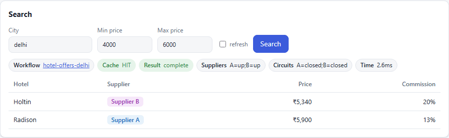

# Demo guide

How to demonstrate each behaviour from a terminal. Every "expected" result below was captured from a real
run of the local stack. Timings come from one laptop and will vary. For a timed 3-minute screen-recording
script that uses the ops console, see [DEMO_SCRIPT.md](DEMO_SCRIPT.md).

## Setup

```bash
cp .env.example .env
docker compose up --build -d --wait        # all six services healthy
B=localhost:3000; J='content-type: application/json'
curl -s -XDELETE $B/admin/chaos            # every supplier up, circuits closed
```

Keep these open alongside:

- the console at <http://localhost:3000/console>, which has buttons for every chaos step below;
- the Temporal UI at <http://localhost:8080>.

If the stack has an `ADMIN_TOKEN`, add `-H "x-admin-token: $ADMIN_TOKEN"` to the `/admin` calls.

## 1. Normal hotel aggregation

```bash
curl -i "$B/api/hotels?city=delhi"
```

Expected: `200`, `X-Result-Status: complete`, `X-Suppliers-Status: A=up;B=up`, `X-Cache: MISS`, and 7
hotels sorted by price:

- Ibis 2900 (B)
- Lemon Tree 3200 (A)
- Holtin 5340 (B, cheaper)
- Radison 5900 (A, cheaper)
- Hyatt Regency 8400 (B, equal price, higher commission)
- The Leela 9800 (A)
- Taj Palace 11900 (B)

The body is a bare array of `{name, price, supplier, commissionPct}`.

To see this run in the Temporal UI, open the `X-Workflow-Id` (`hotel-offers-delhi`) and the
`X-Workflow-Run-Id`. Its history shows two `fetchSupplierHotels` activities scheduled together, then
`persistOffers`.

## 2. Supplier A failure

```bash
curl -XPOST $B/admin/chaos/suppliers/A -H "$J" -d '{"mode":"down"}'
curl -i "$B/api/hotels?city=delhi"
curl $B/health
curl -XDELETE $B/admin/chaos
```

Expected:

- `200` with `X-Result-Status: partial` and `X-Suppliers-Status: A=down;B=up`.
- 6 hotels, all from Supplier B: Ibis 2900, Holtin 5340, Radison 6150, Hyatt Regency 8400, The Leela 10200,
  Taj Palace 11900. Lemon Tree is missing because only A sells it.
- About 2.2 s, spent on Temporal retrying A three times.
- `/health` reports `"status":"degraded"`, with `supplierA` `down` (`HTTP 503`).

## 3. Supplier B failure

```bash
curl -XPOST $B/admin/chaos/suppliers/B -H "$J" -d '{"mode":"down"}'
curl -i "$B/api/hotels?city=delhi"
curl -XDELETE $B/admin/chaos
```

Expected: `200` with `X-Result-Status: partial` and `X-Suppliers-Status: A=up;B=down`, and 6 hotels from
Supplier A: Lemon Tree 3200, Radison 5900, Holtin 6000, Hyatt Regency 8400, The Leela 9800, Taj Palace 12500.

**Cache policy:** if delhi already had a complete cached result, this partial run does **not** replace it. The
worker logs `cache write skipped` with `"outcome":"kept_complete"`, and a filtered request
(`?city=delhi&minPrice=0`) still serves the complete data with `X-Cache: HIT` and
`X-Result-Status: complete`.

## 4. Both suppliers failing

```bash
curl -XPOST $B/admin/chaos/suppliers/A -H "$J" -d '{"mode":"down"}'
curl -XPOST $B/admin/chaos/suppliers/B -H "$J" -d '{"mode":"down"}'
curl -i "$B/api/hotels?city=delhi"
curl -XDELETE $B/admin/chaos
```

Expected: `503` with
`{"error":{"code":"SUPPLIERS_UNAVAILABLE","message":"All suppliers are unavailable",...}}`. It is not `[]`,
which would wrongly claim delhi has no hotels. Nothing is written to Redis, so an existing cached entry
survives.

## 5. Price filtering inside Redis

```bash
curl -i "$B/api/hotels?city=delhi&minPrice=4000&maxPrice=6000"   # Holtin 5340, Radison 5900
curl -i "$B/api/hotels?city=delhi&minPrice=5340&maxPrice=5340"   # Holtin (bounds are inclusive)
curl -i "$B/api/hotels?city=delhi&maxPrice=3000"                 # Ibis
curl -i "$B/api/hotels?city=delhi&minPrice=20000"                # []
curl -i "$B/api/hotels?city=delhi&minPrice=9000&maxPrice=5000"   # 400 VALIDATION_ERROR
```

Expected:

- The first request is `X-Cache: MISS` if delhi was not cached: the workflow ran first, and its result was
  then filtered by Lua.
- The next ones are `X-Cache: HIT`, with `X-Response-Time` around 5 ms in our run.

To see that the filtering happens in Redis, watch it:

```bash
docker compose exec redis redis-cli MONITOR | grep -i "evalsha\|zrangebyscore"
```

Each filtered request shows one `EVALSHA` with the bounds, and the `ZRANGEBYSCORE` that ran inside the
script. `test/integration/cachePolicy.test.ts` asserts the same thing automatically.



## 6. Request coalescing

```bash
npm ci                    # once; needs Node 24
npm run demo:coalescing
```

Expected (real output):

```text
20 concurrent requests in 2099ms
workflow ids:  hotel-offers-delhi
distinct runs: 1  01a1ff77-db9c-7080-af45-5c922349d006
PASS: all 20 requests shared one workflow execution
```

The 20 responses share one `X-Workflow-Run-Id`. The response from the request that started the run carries
`X-Coalesced: false`, and the joined ones carry `X-Coalesced: true`. The api's
`workflow started or joined` and `workflow completed` log lines show `requestId` and `originRequestId` for
each. For the full on/off comparison, run `ADMIN_TOKEN=<token> npm run benchmark`. That needs a stack started
with the same `ADMIN_TOKEN`; see [benchmarks.md](benchmarks.md).

## 7. Circuit breaker

```bash
curl -XPOST $B/admin/chaos/suppliers/B -H "$J" -d '{"mode":"down"}'
for i in 1 2 3; do curl -s -XPOST $B/admin/monitor/probe-now >/dev/null; done
curl $B/admin/circuits
curl -i "$B/api/hotels?city=delhi"
curl -XDELETE $B/admin/chaos
```

Expected:

- After 3 failed probes, `/admin/circuits` shows `"B":{"state":"open","consecutiveFailures":3,...}`.
- The search returns `200` partial with `X-Circuit-State: A=closed;B=open`, in **273 ms** in our run. With B
  down but the circuit still closed, the same request took 2201 ms, because each request retried B.
- `DELETE /admin/chaos` resets the circuits.
- Without `probe-now`, the monitors probe every 15 s on their own, so the circuit opens within about 45 s.
- After the 30 s cooldown, a half-open probe closes the circuit again once B is back up.

## Reset

```bash
curl -XDELETE $B/admin/chaos     # suppliers up, circuits closed, warm-up cities' caches cleared
```

## Screenshots

`npm run screenshots` regenerates every image in `docs/images/` from the running stack (Playwright). See the
header of `scripts/screenshots.ts` for the optional newman HTML report image.
