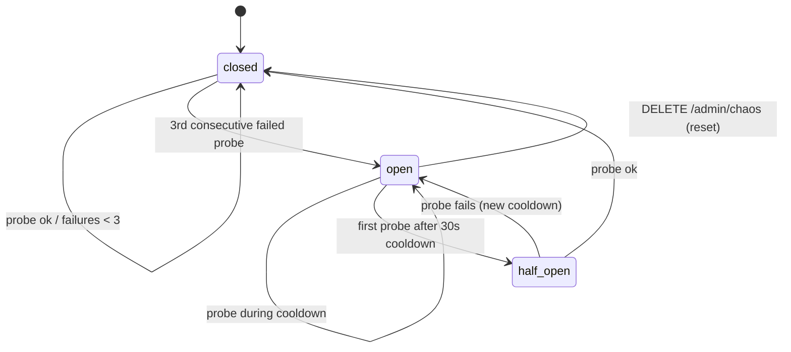

# Design notes

The longer reasoning behind the design. The [README](../README.md) has the short version.

**Temporal for orchestration.** Fan-out, retries with backoff, timeouts, partial failure and "what happened in
this request?" are exactly what Temporal provides. Each request leaves a durable, inspectable history in the
UI: every attempt, failure and result. Retry policies are declared, so there are no hand-written retry loops.
Live state can be read with a query, and a crashed worker resumes rather than losing the request.

**Parallel `Promise.allSettled`, and why partial results are allowed.** The suppliers are independent, so they
are fetched concurrently and the latency is the slower one, not the sum. `allSettled` (not `all`) means one
supplier failing can't cancel the other. For a shopper, some offers are better than an error page, so a
single-supplier failure returns `200` with `X-Result-Status: partial`. Only when **both** fail is the answer
`503 SUPPLIERS_UNAVAILABLE`. Returning `[]` there would wrongly claim the city has no hotels.

**Retry and timeout values.**

| Setting                        | Value                                 | Why                                                                                                                                                  |
| ------------------------------ | ------------------------------------- | ---------------------------------------------------------------------------------------------------------------------------------------------------- |
| supplier `startToCloseTimeout` | 4s                                    | Healthy mock calls take under 100 ms, and 4 s bounds a hung supplier.                                                                                |
| HTTP abort (`AbortController`) | 3.5s                                  | Slightly under 4 s, so the activity reports a clean, typed `SupplierTimeout` itself, with Temporal's timeout as the backstop.                        |
| retry policy                   | 300ms initial, ×2, max 2s, 3 attempts | Rides out transient blips; the worst case for a dead supplier is about 3 × 4 s plus backoff ≈ 13 s.                                                  |
| workflow execution timeout     | 30s                                   | A hard ceiling on what a client can wait.                                                                                                            |
| persist activity               | 5s, 5 attempts                        | Redis blips should not throw away a good result.                                                                                                     |
| `TEMPORAL_START_TIMEOUT_MS`    | 5s                                    | Without a gRPC deadline, the SDK's retry interceptor kept a request hanging **~92 s** while Temporal was down (measured). Now it returns 503 in 5 s. |

Every value is configurable through env (see [CONFIGURATION.md](CONFIGURATION.md)). The API passes it into the
workflow as input, because workflow code can't read env and the values then get recorded in history. On the
self-hosted server, retry gaps are observed to be about 1 s, because of the server's timer granularity.

**Non-retryable errors.** A `4xx` response (`SupplierClientError`) or a payload that isn't a JSON array
(`SupplierInvalidPayload`) won't fix itself on retry, so the activity throws `ApplicationFailure.nonRetryable`
and the types are also listed in `nonRetryableErrorTypes`. `5xx`, network errors and timeouts are retried.
**Individual** malformed records are dropped and logged with their zod issues; one bad row shouldn't discard a
supplier's whole inventory.

**Tie-break rule (a business decision).** The lower price wins. On an equal price, the **higher
`commissionPct`** wins, because the customer pays the same and our margin is better (that's why Hyatt Regency
goes to Supplier B). If commission is also equal, **Supplier A** wins, so the output is fully deterministic and
replay-safe. Each decision is recorded as `cheaper`, `tie_higher_commission`, `tie_default` or `single_source`.

**Invalid commission.** A commission that is missing, `null`, non-numeric, `NaN`, infinite or negative is
treated as the **lowest** tie-break priority. It can never beat a valid commission, and it never affects the
price comparison. Two invalid commissions tie, so Supplier A wins. The offer stays in the output with
`commissionPct: 0`, which keeps the 4-key contract numeric. An offer with an invalid price or an empty name is
skipped, because it cannot be ranked.

**Name normalisation.** The dedupe key is `normalizeHotelName`: Unicode NFC → trim → collapse any whitespace
(including non-breaking spaces) → lowercase. So `" holtin "`, `"HOLTIN"` and `"Holtin"` are one hotel, and a
precomposed `"é"` matches `"e" + combining accent`. NFKC was rejected: it also folds compatibility characters
(for example `"Ⅱ"` → `"II"`), which could merge names that are genuinely different. Similar-looking names
("Leela Palace" vs "Pearl Palace") are never merged by the selection key. Duplicates are also removed _within_ a single supplier, keeping the
cheapest offer. The output keeps the winner's cleaned display name. `selectBestOffers` is pure: there are no
Node imports, clocks or randomness, and ESLint enforces this. That lets it run inside the workflow sandbox.

**Redis: sorted set + hash + Lua, server-side and atomic.**

- `hotels:{city}:by_price` is a ZSET (member = normalised name, score = price), so range queries are
  `O(log n + m)`.
- `hotels:{city}:offers` is a HASH from name to the 4-field offer JSON.
- `hotels:{city}:meta` is a HASH with `fetchedAt`, `generation`, `workflowId`, `runId`, `requestId`, `count`,
  `suppliersStatus`, `resultStatus`, `ttlSeconds` and `decisions`.

Writes use one Lua script, `writeCityOffers.lua` (version check → DEL → HSET meta → ZADD/HSET → EXPIRE ×3).
Redis runs a script atomically, so a reader never sees a half-written city. Reads are **one `EVALSHA`** of
`filterByPrice.lua`: it checks that the city exists (HIT/MISS), runs `ZRANGEBYSCORE min max` (inclusive, with `-inf`/`+inf`), and `HMGET`s the offers. That is one atomic round trip
with no TOCTOU gap between "is it cached?" and "read it". It returns results already sorted by
`(price, name)`, the same order the workflow produces. No filtering happens in JavaScript.

**Hash-tagged keys.** The `{city}` part makes all three keys of a city hash to the same Redis Cluster slot, so
both multi-key Lua scripts stay valid if Redis is later sharded.

**TTL, with a shorter TTL for partial results.** Full results live for `CACHE_TTL_SECONDS` (300). A partial
result lives for only `PARTIAL_CACHE_TTL_SECONDS` (30), so once a supplier recovers, the cache heals quickly
instead of serving one-sided data for five minutes. Meta is written even when a city has 0 hotels, so "no
hotels" is a cached `HIT` and not a workflow run on every request.

**Versioned writes and the partial-result policy.** Each workflow run stamps a `generation` (its start time, in
ms, recorded in workflow history, so it is replay-safe). `writeCityOffers.lua` compares it with the cached
`generation` inside the same atomic script:

- An **older** generation than the cached one returns `stale`, so a late or slow run can never roll the cache
  back. The same generation is accepted, so a retried persist of the same run is idempotent.
- A **partial** result never replaces a still-valid **complete** entry (`kept_complete`). One supplier blipping
  must not throw away good data for the full 5 minutes. A partial result still fills an empty slot, with the
  30 s TTL, and any newer complete result replaces it.
- Both suppliers down: the workflow fails before persisting, so the cache is never deleted or degraded.

The API's response for **that** request is unchanged: an unfiltered request still returns the run's own (partial)
result with `X-Result-Status: partial`. A filtered request reads from Redis, so when the complete entry was kept,
its headers describe the data actually served (`X-Cache: HIT`, the cached run ID and `resultStatus`). Distributed
locks were not needed: a version check inside one atomic script solves the ordering problem.

**Request coalescing.** The workflow ID is deterministic per city (`hotel-offers-<city>`). It is started with
`workflowIdConflictPolicy: 'USE_EXISTING'`, which Temporal TS SDK 1.26 supports natively, so no
`WorkflowExecutionAlreadyStartedError` fallback is needed, and with `workflowIdReusePolicy: 'ALLOW_DUPLICATE'`.
While a run for `delhi` is in flight, 50 concurrent requests attach to it and the suppliers are called **once**.
After it closes, the next request starts a fresh run. `X-Workflow-Run-Id` shows this: coalesced requests share
a run ID.

**A circuit breaker driven by the monitor, not by request failures.** The breaker opens on
`CIRCUIT_FAILURE_THRESHOLD` (3) consecutive failed **monitor probes**, and the first probe after
`CIRCUIT_COOLDOWN` (30 s) runs half-open: success closes the circuit, failure re-opens it. A request-driven
breaker would make the decision depend on traffic shape. With no traffic it never learns a supplier recovered,
and with heavy traffic it trips on a burst of user requests that all share one slow attempt. Probes run at a
fixed, known rate, so the breaker is predictable, testable on Temporal's time-skipping server, and separate
from request latency. The monitor workflow owns the state machine (`domain/circuit.ts`, pure) and persists
every sample and transition to Redis. `fetchSupplierHotels` only _reads_ the circuit and throws a
non-retryable `CircuitOpen`, which the request workflow already treats as "supplier down", so the graded
headers stay the same (`X-Suppliers-Status: …B=down`) and only `X-Circuit-State` is new. It's a durable
timer (`condition(…, interval)`), so a worker restart doesn't lose the schedule, and continue-as-new every
`MONITOR_CONTINUE_AS_NEW_EVERY` (100) iterations keeps history bounded while carrying the circuit and counters.
`DELETE /admin/chaos` resets circuits too, through Redis and a `resetCircuit` signal, so test runs stay repeatable.

**Cache warm-up with a Temporal Schedule.** At boot the worker creates the `cache-warmup` Schedule, or updates
it if it already exists, so changed `WARMUP_*` values apply on the next deploy. Each tick runs
`cacheWarmupWorkflow`, which starts one **child** `hotelOffersWorkflow` per city with the user-request ID
`hotel-offers-<city>`.

- **A user request during a warm-up** attaches to the child (the client uses `USE_EXISTING`).
- **A warm-up during a user request:** child workflows can't use `USE_EXISTING` (Temporal omits it from
  `ChildWorkflowOptions`), so the child start is rejected as already-started and that city is reported
  `coalesced`. It is being refreshed anyway.
- **Parent-close policy `ABANDON`:** user requests may be attached to a child, so terminating a warm-up must
  never kill them.
- **Overlap policy `SKIP`:** a slow tick never queues up behind another.

The result is that filtered requests for warm-up cities are almost always `X-Cache: HIT` (served by one Lua
call in about 5 ms), while the unfiltered endpoint still runs a fresh workflow as the contract requires.
`DELETE /admin/chaos` also clears the warm-up cities' caches, so a warm-up that ran during a "supplier down"
test can't leave partial data behind.

**Near-duplicate detection is report-only.** Suppliers name the same property differently ("Radisson Blu" vs
"Radison Blu", "The Leela Palace" vs "Leela Palace"). The graded endpoint still dedupes by **exact normalized
name**, as required. `duplicateReviewWorkflow` only **reports** likely duplicates in
`GET /api/hotels/insights` → `possibleDuplicates`:

- **Scoring:** `domain/similarity.ts` (hand-written Jaro-Winkler and token-set similarity; punctuation,
  stop-words such as "the", "hotel" and "resort", and the city name are normalized away) scores pairs from
  _different_ suppliers whose normalized names differ.
- **Mutual best match:** a pair is kept only when each listing is the other's best match, so "The Leela Palace"
  isn't also paired with "Pearl Palace" at 0.79.
- **≥ 0.92:** reported as `likely_same`, decided by `similarity`.
- **0.75–0.92:** an **LLM judge activity** (Experimental: tested with mocks; the deterministic `uncertain` fallback is the default) decides `likely_same`, `different` or `uncertain`, with a one-line
  reason. It's an activity, never workflow code, because model output is non-deterministic. With no LLM
  configured, the pair is reported `uncertain`, decided by `similarity`.
- **Below 0.75:** ignored.

The review is cached in the city's Redis meta (written only while that meta exists) and disappears on the next
refresh, so it never describes stale data. Merging automatically would be risky, because a wrong merge hides a
real hotel or misprices one. A production system would use shared property IDs (supplier mapping, GIATA-style
codes) or a mapping service with human review. This feature surfaces candidates for that process.

**No envelope in the response.** The contract asks for a bare array, and keeping metadata in headers makes
the body exactly the domain data. Clients can `JSON.parse` it straight into a list, and HTTP caches and
intermediaries handle it naturally. The body is built with an explicit 4-key projection, so internal fields
can never leak.
